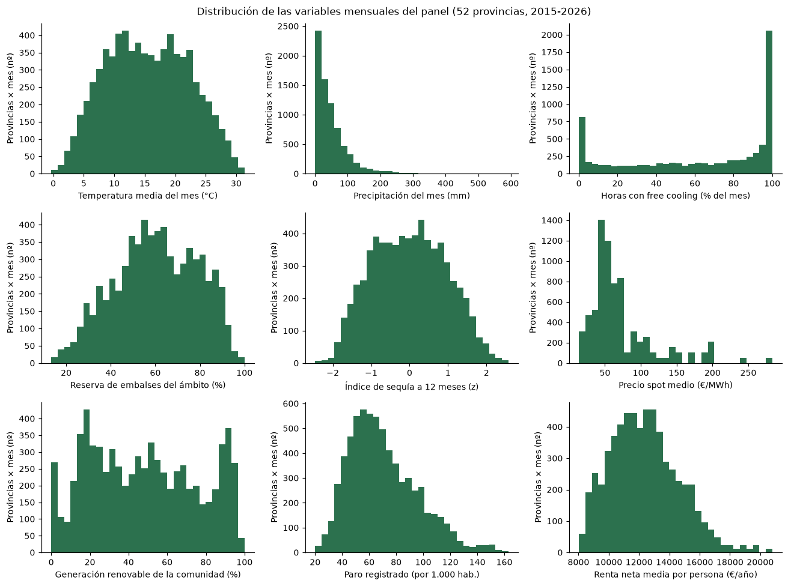
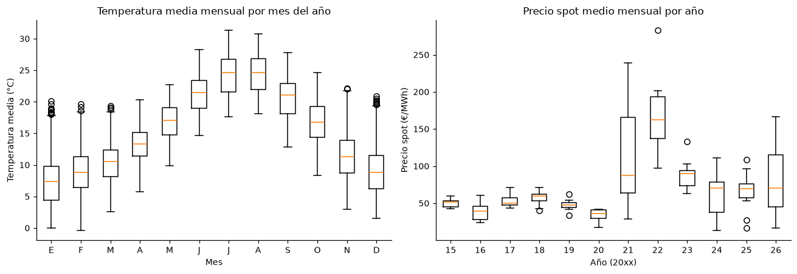
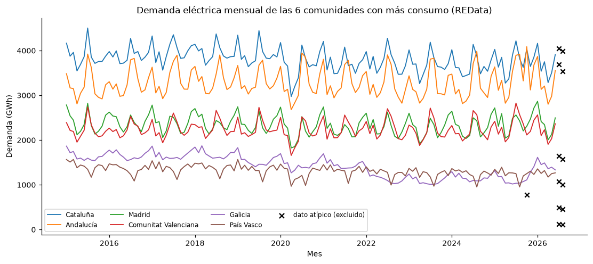
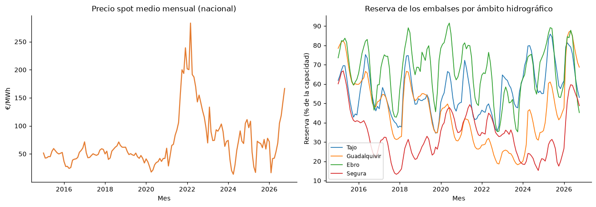
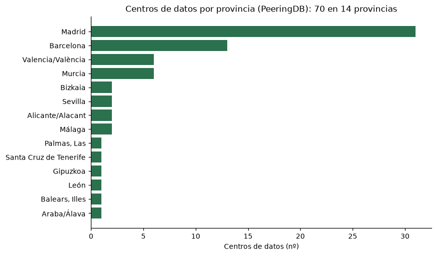
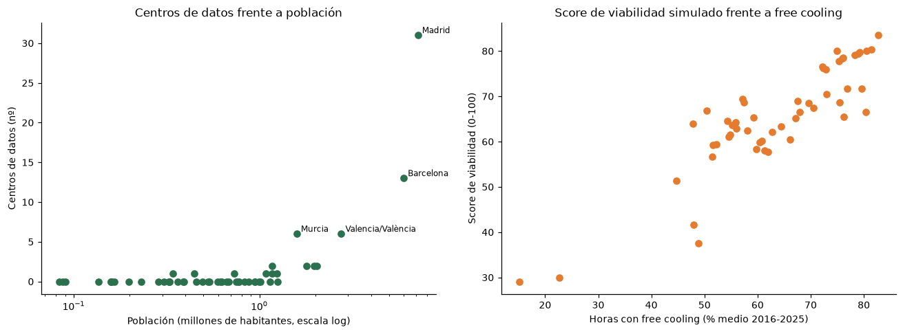
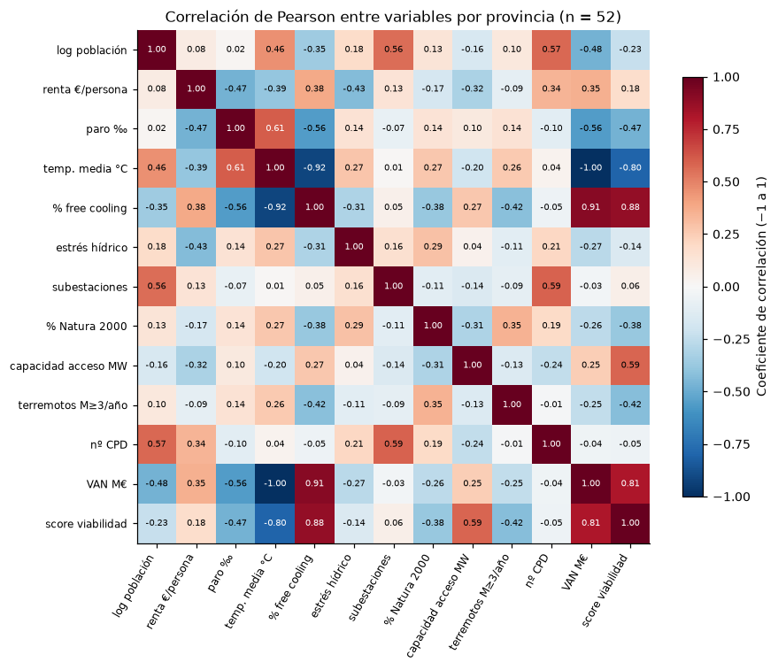
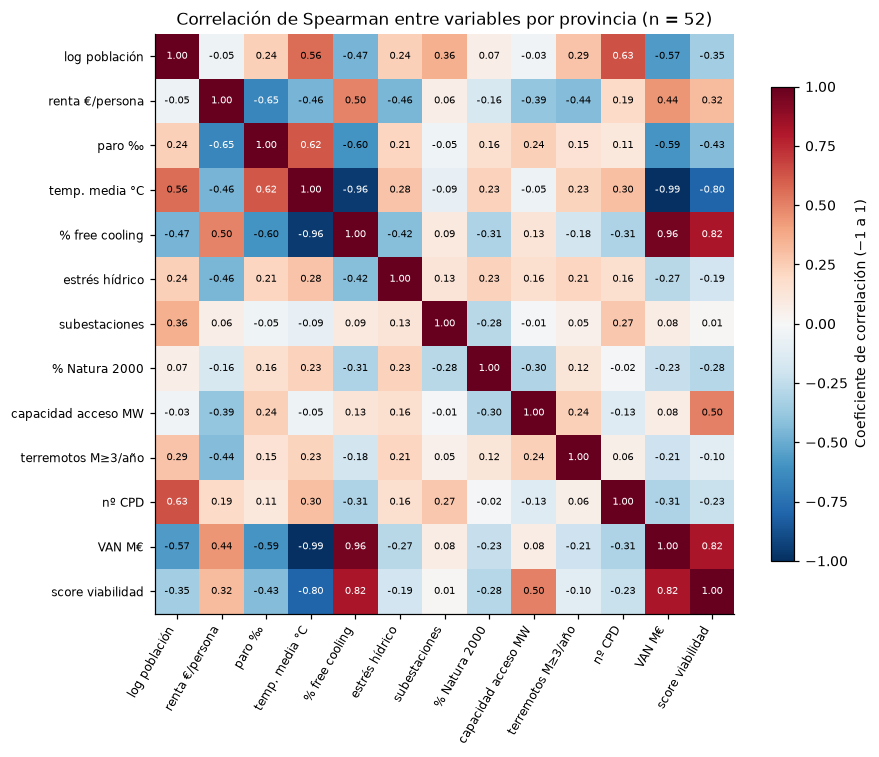
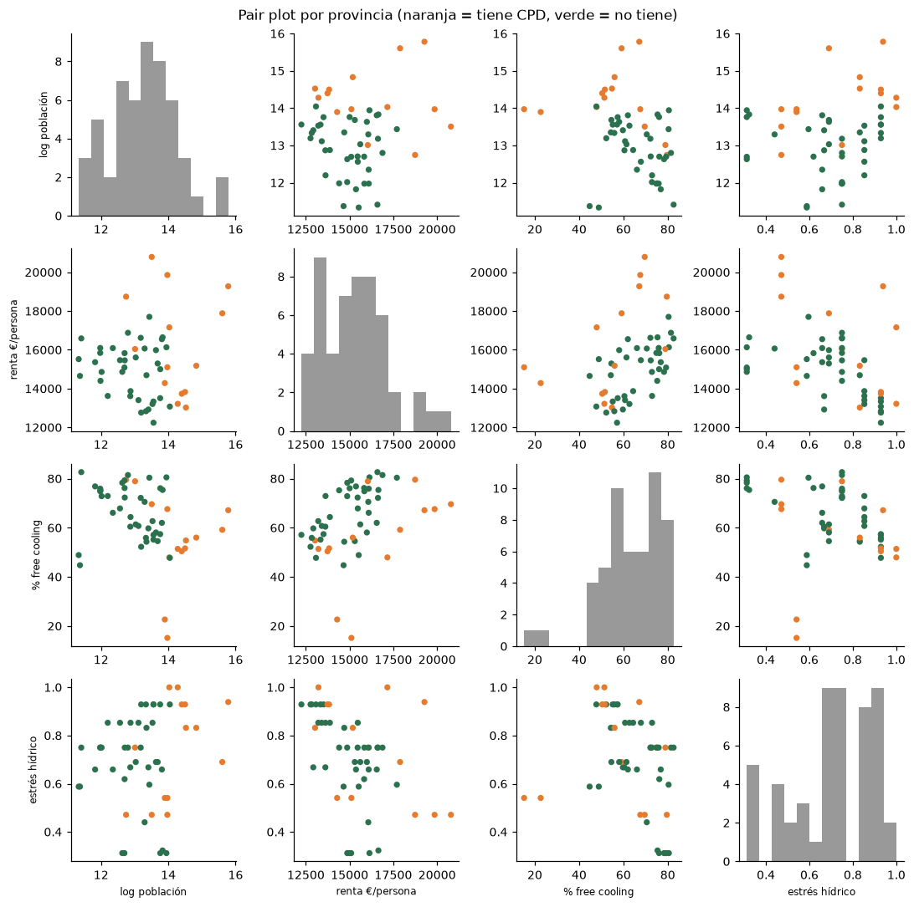

# Informe de análisis exploratorio · panel provincia × mes

> Generado por `python -m cpd.modelos` el 17/11/2026. No editar a mano: se sobrescribe al volver a ejecutar.

Fase 4 de [la metodología](../metodologia/03_Flujo_de_trabajo.md). Responde a B5 (EDA) y B6 (correlaciones con la
viabilidad) de la [checklist](../metodologia/06_Checklist_entrega.md). Código: `src/cpd/modelos/eda.py`.

## 1. Resumen general

**Datos.** `data/curated/panel_provincia_mes`: 7.384 filas (52 provincias × meses de
2015-01 a 2026-10) y 51 columnas. Una fila = provincia × mes (R-11).
Las variables de comunidad (demanda, capacidad de acceso, estrés hídrico) se repiten en cada provincia de la comunidad.

Tabla de una página: tipo, nulos, rango y cardinalidad de cada columna

| Columna | Tipo | Nulos | Mínimo | Máximo | Distintos |
|---|---|---|---|---|---|
| codigo_provincia | texto | 0,0 % |  |  | 52 |
| mes | fecha | 0,0 % |  |  | 142 |
| provincia | texto | 0,0 % |  |  | 52 |
| ccaa | texto | 0,0 % |  |  | 19 |
| codigo_ccaa | texto | 0,0 % |  |  | 19 |
| ambito_hidrografico | texto | 9,6 % |  |  | 16 |
| tmedia_mes_c | numérica | 0,0 % | -0.34 | 31.36 | 7330 |
| tmax_media_c | numérica | 0,0 % | 3.15 | 40.53 | 7326 |
| tmin_media_c | numérica | 0,0 % | -3.43 | 27.87 | 7315 |
| precipitacion_mes_mm | numérica | 0,0 % | 0.0 | 592.4 | 6322 |
| humedad_relativa_media_pct | numérica | 0,0 % | 21.66 | 95.73 | 7348 |
| viento_medio_kmh | numérica | 0,0 % | 5.38 | 33.85 | 6941 |
| radiacion_solar_media_kwh_m2_dia | numérica | 0,0 % | 3.91 | 30.22 | 6383 |
| et0_hargreaves_mes_mm | numérica | 0,0 % | 16.15 | 248.31 | 7322 |
| dias_con_clima | numérica | 0,0 % | 28.0 | 31.0 | 4 |
| dias_mas_35c | numérica | 0,0 % | 0.0 | 31.0 | 32 |
| horas_free_cooling | numérica | 0,0 % | 0.0 | 744.0 | 744 |
| pct_horas_free_cooling | numérica | 0,0 % | 0.0 | 100.0 | 1444 |
| balance_hidrico_mes_mm | numérica | 0,0 % | -248.3 | 486.2 | 3005 |
| precipitacion_12m_mm | numérica | 7,7 % | 96.44 | 2080.49 | 6655 |
| indice_sequia_12m | numérica | 7,7 % | -2.46 | 2.57 | 453 |
| reserva_hidrica_pct | numérica | 9,6 % | 13.28 | 100.0 | 1843 |
| reserva_hidrica_hm3 | numérica | 9,6 % | 11.4 | 9490.5 | 2005 |
| capacidad_embalses_ambito_hm3 | numérica | 9,6 % | 21.0 | 11056.0 | 49 |
| semanas_reserva_mes | numérica | 9,6 % | 4.0 | 5.0 | 2 |
| estres_hidrico_wri_0_1 | numérica | 0,0 % | 0.31 | 1.0 | 17 |
| demanda_ccaa_mwh | numérica | 2,6 % | 13780.95 | 4505638.56 | 2635 |
| generacion_total_ccaa_mwh | numérica | 1,3 % | 13780.95 | 4314514.93 | 2668 |
| generacion_renovable_ccaa_mwh | numérica | 1,3 % | 0.0 | 3145649.24 | 2540 |
| pct_renovable_ccaa | numérica | 1,3 % | 0.0 | 99.97 | 2182 |
| emisiones_co2_nacional_tco2eq | numérica | 0,0 % | 1675647.68 | 8823684.35 | 142 |
| precio_spot_medio_mes_eur_mwh | numérica | 0,0 % | 13.67 | 283.3 | 142 |
| precio_pvpc_medio_mes_eur_mwh | numérica | 54,2 % | 85.58 | 395.23 | 65 |
| poblacion | numérica | 7,0 % | 83039.0 | 7137031.0 | 572 |
| renta_neta_media_persona_eur | numérica | 17,4 % | 8029.0 | 20790.0 | 493 |
| renta_neta_media_hogar_eur | numérica | 17,4 % | 21514.0 | 51928.0 | 503 |
| mediana_renta_unidad_consumo_eur | numérica | 17,4 % | 10150.0 | 26950.0 | 28 |
| paro_registrado | numérica | 0,7 % | 2216.0 | 508448.0 | 7082 |
| paro_por_1000_hab | numérica | 7,7 % | 19.97 | 162.94 | 4689 |
| n_centros_datos | numérica | 0,0 % | 0.0 | 31.0 | 6 |
| n_ixp | numérica | 0,0 % | 0.0 | 7.0 | 3 |
| distancia_ixp_km | numérica | 0,0 % | 0.0 | 1754.1 | 50 |
| subestaciones_220_400kv | numérica | 0,0 % | 0.0 | 59.0 | 26 |
| subestaciones_400kv | numérica | 0,0 % | 0.0 | 17.0 | 14 |
| pct_superficie_natura2000 | numérica | 0,0 % | 4.4 | 47.58 | 52 |
| espacios_natura_2000 | numérica | 0,0 % | 2.0 | 140.0 | 36 |
| nudos_acceso_ccaa | numérica | 1,9 % | 1.0 | 117.0 | 16 |
| capacidad_demanda_rdt_disponible_mw | numérica | 1,9 % | 0.0 | 13465.0 | 16 |
| n_terremotos | numérica | 0,0 % | 0.0 | 8132.0 | 98 |
| magnitud_max | numérica | 27,8 % | 1.6 | 5.2 | 34 |
| n_terremotos_m3_plus | numérica | 0,0 % | 0.0 | 2354.0 | 17 |

**Nulos que importan.** El PVPC solo existe desde junio de 2021; la renta del INE llega hasta 2024; las reservas de
embalses no cubren Baleares, Canarias, Ceuta ni Melilla; el índice de sequía necesita 12 meses previos. No se imputa
nada en el panel (R-1); los modelos tratan los huecos a su manera y lo documentan.

## 2. Distribuciones (univariante)

**Figura 1.** Histogramas de las variables mensuales. Las horas de free cooling tienen forma de U: muchos meses con
el 100 % (invierno) o casi el 0 % (verano en el sur). La precipitación (asimetría 2,27) y el
precio spot (1,92) tienen una cola larga a la derecha; la renta
(0,55) y el paro (0,76) son algo asimétricos. En las
variables con cola larga conviene el logaritmo o Spearman (C4 p.25; C2 p.23).

**Figura 2.** Box plots. La temperatura tiene una estacionalidad clara: la mediana va de 7,4 °C en
enero a 24,6 °C en agosto. El precio spot
cambia de nivel por años: media de 167,7 €/MWh en 2022 frente a 47,7 en 2019. 2022
es un atípico real (crisis del gas), no un error, y se conserva (R-10).

## 3. Series temporales

**Figura 3.** Demanda eléctrica mensual de las seis comunidades con más consumo. Se ven la estacionalidad (picos en
invierno y verano), la caída del confinamiento (abril de 2020) y una bajada lenta después: la suma de las 19
comunidades pasa de 256,5 TWh en 2021 a 246,7 TWh en 2023. Las cruces son datos atípicos que
se excluyen del modelado (ver el apartado 7).

**Figura 4.** Precio spot mensual y reserva de los embalses de cuatro ámbitos (Guadalquivir: mínimo del 18,2 % en 2023-10; Segura: mínimo del 13,3 % en 2017-11). El precio baja desde el
máximo de 2022 a una media anual de 63-83 €/MWh en 2024-2026, todavía por encima de
2015-2019 (40-57 €/MWh).

## 4. Centros de datos y variables por provincia

**Figura 5.** 70 centros de datos en 14 provincias (PeeringDB). Madrid y Barcelona concentran el
63 %. La etiqueta del modelo `prob_cpd` es
"tiene al menos uno" (14 de 52 provincias).

**Figura 6.** Izquierda: los CPD aparecen en las provincias más pobladas (relación monótona pero no lineal: por eso se
usa Spearman y el logaritmo de la población). Derecha: el score de viabilidad simulado sube con el free cooling.

## 5. Correlaciones (Pearson, Spearman y Kendall)

**Método.** Matrices de correlación por provincia (n = 52) con Pearson (lineal, sensible a atípicos) y Spearman
(monótona, por rangos) [C2 p.23-24]. Kendall se calcula en el código (`cpd.modelos.eda.correlaciones`) para
comprobar la robustez con una muestra tan pequeña.

**Figuras 7 y 8.** Matrices de correlación de Pearson y Spearman.

| Variable | Spearman con nº CPD | Pearson con nº CPD | Spearman con score | Spearman con VAN |
|---|---|---|---|---|
| log población | 0,63 | 0,57 | -0,35 | -0,57 |
| renta €/persona | 0,19 | 0,34 | 0,32 | 0,44 |
| paro ‰ | 0,11 | -0,10 | -0,43 | -0,59 |
| temp. media °C | 0,30 | 0,04 | -0,80 | -0,99 |
| % free cooling | -0,31 | -0,05 | 0,82 | 0,96 |
| estrés hídrico | 0,16 | 0,21 | -0,19 | -0,27 |
| subestaciones | 0,27 | 0,59 | 0,01 | 0,08 |
| % Natura 2000 | -0,02 | 0,19 | -0,28 | -0,23 |
| capacidad acceso MW | -0,13 | -0,24 | 0,50 | 0,08 |
| terremotos M≥3/año | 0,06 | -0,01 | -0,10 | -0,21 |

**Interpretación.**

- **Correlación no es causalidad** [C2 p.18-21]. Que las provincias con más población tengan más CPD no prueba que la
  población los atraiga: también se concentran allí la fibra, los IXP, las empresas clientes y la demanda.
- El **número de CPD** se relaciona sobre todo con la población (Spearman 0,63).
  El clima y el agua apenas se relacionan con dónde están hoy los CPD.
- El **VAN simulado** depende casi solo de la temperatura (Spearman -0,99): en el simulador, la única
  diferencia económica entre provincias es el PUE, que se estima a partir del clima. Por eso el VAN solo varía unos
  pocos millones entre provincias y la clase de rentabilidad del mapa es tan sensible.
- El VAN simulado y el número real de CPD van en **sentido contrario** (Spearman -0,31): el simulador
  premia el clima frío, mientras que el mercado se ha instalado donde están la conectividad y los clientes. Es una
  limitación del simulador que hay que explicar en la memoria y que el modelo `prob_cpd` ayuda a ver.

**Multicolinealidad** (|Spearman| ≥ 0,8, recomendación, no viene de clase):

- temp. media °C y VAN M€: Spearman -0,99
- temp. media °C y % free cooling: Spearman -0,96
- % free cooling y VAN M€: Spearman 0,96
- VAN M€ y score viabilidad: Spearman 0,82
- % free cooling y score viabilidad: Spearman 0,82
- temp. media °C y score viabilidad: Spearman -0,80

Decisión: en los modelos se conserva el % de free cooling o la temperatura con cuidado; en la regresión logística, la
regularización L2 reparte el peso entre las dos.

**Diferencias grandes entre Pearson y Spearman** (indican atípicos o relaciones no lineales):

- capacidad acceso MW y terremotos M≥3/año: |Pearson − Spearman| = 0,37
- renta €/persona y terremotos M≥3/año: |Pearson − Spearman| = 0,34
- terremotos M≥3/año y score viabilidad: |Pearson − Spearman| = 0,32
- estrés hídrico y terremotos M≥3/año: |Pearson − Spearman| = 0,32
- subestaciones y nº CPD: |Pearson − Spearman| = 0,32
- temp. media °C y nº CPD: |Pearson − Spearman| = 0,27

## 6. Pair plot

**Figura 9.** Pair plot de cuatro variables por provincia, en naranja las que tienen CPD. Las provincias con CPD se
separan sobre todo por la población; en renta, free cooling y estrés hídrico se mezclan con las demás.

## 7. Datos atípicos de la demanda (R-10)

Regla (`cpd.fuentes.calidad.marcar_atipicos_demanda`, aplicada en el curado): demanda ≤ 0, cociente con el mismo mes
del año anterior fuera de [0,6; 1,6] o mes en el que fallan la mitad o más de las comunidades peninsulares (fallo de
la fuente). Los valores marcados quedan en NaN en el panel; el original y el motivo se guardan en
`data/curated/calidad_demanda_ccaa.csv`.

| Comunidad | Mes | Demanda (GWh) | Cociente interanual | Motivo |
|---|---|---|---|---|
| Asturias | 2025-10 | 357,1 | 0,48 | cociente interanual fuera de [0.6, 1.6] |
| Comunidad Foral de Navarra | 2025-10 | 239,8 | 0,57 | cociente interanual fuera de [0.6, 1.6] |
| País Vasco | 2025-10 | 776,1 | 0,59 | cociente interanual fuera de [0.6, 1.6] |
| Andalucía | 2026-07 | 4.050,5 | 1,04 | fallo de la fuente en el mes |
| Aragón | 2026-07 | 2.112,5 | 2,22 | cociente interanual fuera de [0.6, 1.6] |
| Asturias | 2026-07 | 552,3 | 0,80 | fallo de la fuente en el mes |
| Cantabria | 2026-07 | -7,1 | -0,02 | demanda ≤ 0 |
| Castilla y León | 2026-07 | 3.048,8 | 2,65 | cociente interanual fuera de [0.6, 1.6] |
| Castilla-La Mancha | 2026-07 | 3.296,4 | 2,85 | cociente interanual fuera de [0.6, 1.6] |
| Cataluña | 2026-07 | 3.690,3 | 0,88 | fallo de la fuente en el mes |
| Comunitat Valenciana | 2026-07 | 1.648,8 | 0,58 | cociente interanual fuera de [0.6, 1.6] |
| Extremadura | 2026-07 | 3.267,3 | 7,60 | cociente interanual fuera de [0.6, 1.6] |
| Galicia | 2026-07 | 1.070,0 | 1,03 | fallo de la fuente en el mes |
| Madrid | 2026-07 | 123,1 | 0,05 | cociente interanual fuera de [0.6, 1.6] |
| Región de Murcia | 2026-07 | 1.239,9 | 1,28 | fallo de la fuente en el mes |
| Comunidad Foral de Navarra | 2026-07 | 568,2 | 1,51 | fallo de la fuente en el mes |
| País Vasco | 2026-07 | 493,9 | 0,40 | cociente interanual fuera de [0.6, 1.6] |
| La Rioja | 2026-07 | 241,9 | 1,80 | cociente interanual fuera de [0.6, 1.6] |
| Andalucía | 2026-08 | 3.984,1 | 1,02 | fallo de la fuente en el mes |
| Aragón | 2026-08 | 1.852,2 | 2,04 | cociente interanual fuera de [0.6, 1.6] |
| Asturias | 2026-08 | 539,5 | 0,81 | fallo de la fuente en el mes |
| Cantabria | 2026-08 | -10,7 | -0,03 | demanda ≤ 0 |
| Castilla y León | 2026-08 | 2.589,3 | 2,33 | cociente interanual fuera de [0.6, 1.6] |
| Castilla-La Mancha | 2026-08 | 3.202,2 | 2,96 | cociente interanual fuera de [0.6, 1.6] |
| Cataluña | 2026-08 | 3.540,5 | 0,93 | fallo de la fuente en el mes |
| Comunitat Valenciana | 2026-08 | 1.575,7 | 0,61 | fallo de la fuente en el mes |
| Extremadura | 2026-08 | 2.674,1 | 5,27 | cociente interanual fuera de [0.6, 1.6] |
| Galicia | 2026-08 | 1.009,2 | 0,97 | fallo de la fuente en el mes |
| Madrid | 2026-08 | 109,0 | 0,04 | cociente interanual fuera de [0.6, 1.6] |
| Región de Murcia | 2026-08 | 1.186,9 | 1,31 | fallo de la fuente en el mes |
| Comunidad Foral de Navarra | 2026-08 | 534,5 | 1,44 | fallo de la fuente en el mes |
| País Vasco | 2026-08 | 460,7 | 0,48 | cociente interanual fuera de [0.6, 1.6] |
| La Rioja | 2026-08 | 207,1 | 1,66 | cociente interanual fuera de [0.6, 1.6] |
| Illes Balears | 2026-11 | 173,0 | — | mes en curso (incompleto) |
| Canarias | 2026-11 | 337,8 | — | mes en curso (incompleto) |
| Ceuta | 2026-11 | 7,5 | — | mes en curso (incompleto) |
| Melilla | 2026-11 | 7,8 | — | mes en curso (incompleto) |

**Causa (comprobada el 17/11/2026 con `balance/balance-electrico` de REData).** En julio y agosto de 2026 REData aún
no publica el *saldo de intercambios* de las comunidades peninsulares, y su "demanda en barras de central" es solo la
generación propia: Madrid sale con 72.822 + 50.297 = 123.120 MWh (lo habitual son unos 2.500.000), Cantabria en
negativo y Extremadura o Castilla-La Mancha con cifras de generación. En octubre de 2025 el saldo de intercambios de
Asturias (−289.536 MWh), Navarra y el País Vasco cambia de signo o se dispara y la demanda cae a la mitad. Son datos
provisionales de la fuente, no errores de nuestro proceso: el fichero raw ya los trae así.

**Decisión.** No se corrigen a mano ni se inventan (R-1): quedan en NaN y registrados. Los modelos recortan los huecos
del final y sustituyen los intermedios por el mismo mes del año anterior solo como entrada, marcados con `imputado`.
`cpd.fuentes.ree` vuelve a pedir la demanda de un año hasta 12 meses después de acabar, así que la próxima
actualización (`python -m cpd.fuentes.actualizar`) recogerá las correcciones cuando REData las publique.

## 8. Limitaciones

- n = 52 provincias: cualquier correlación por provincia tiene mucha incertidumbre (una correlación de 0,3 no es
  significativa con este tamaño).
- Las variables de comunidad autónoma se repiten en sus provincias: no aportan variación dentro de la comunidad.
- PeeringDB recoge los centros de datos que se registran para interconexión, no todos los CPD de España.
- El score y el VAN vienen de la simulación del mapa (`frontend/public/data/provincias_simuladas.json`), que usa
  supuestos a calibrar (R-16).

## 9. Decisiones que apoya

1. Modelo de demanda por comunidad con features relativas al nivel reciente (las comunidades tienen escalas muy
   distintas) y con los atípicos de REData excluidos.
2. Modelo `prob_cpd` con el logaritmo de la población y sin `n_ixp` ni `distancia_ixp_km` (fuga).
3. Revisar el simulador: hoy solo distingue provincias por el clima.
