# Previsiones · 1 año (demanda, precio de la luz, reservas de agua, temperatura y renovables) y 10 años (demanda nacional)

> Generado por `python -m cpd.modelos` el 18/11/2026. No editar a mano: se sobrescribe al volver a ejecutar.

Previsión mes a mes de los **12 meses siguientes** al último dato con el modelo que menos se equivoca a 1 año (demanda
por comunidad, precio de la luz, reservas de agua por ámbito, temperatura por provincia y % de generación renovable por
comunidad), y de la demanda nacional a 10 años. Código: `src/cpd/modelos/anual.py` y `src/cpd/modelos/largo_plazo.py`. Las fichas de
modelo de [demanda](../modelos/demanda_ccaa.md) y [precio](../modelos/precio_luz.md) describen las primeras
evaluaciones; este informe es el que alimenta el mapa.

## Control de acierto (requisito: 85 % ≤ acierto < 99,9 %)

**Acierto** = 100 × (1 − WAPE), con WAPE = Σ|real − previsto| / Σ|real| (en clasificación, la accuracy). Se usa el
WAPE y no 100 − MAPE porque el MAPE se dispara en los meses con valores muy bajos: un precio de 16 €/MWh con un error
de 30 €/MWh cuenta como un 190 % de error. Un acierto de 99,9 % o más se marca como **sospechoso**: casi seguro
indica una fuga de información. El control se ejecuta en cada `python -m cpd.modelos` y avisa en la consola.

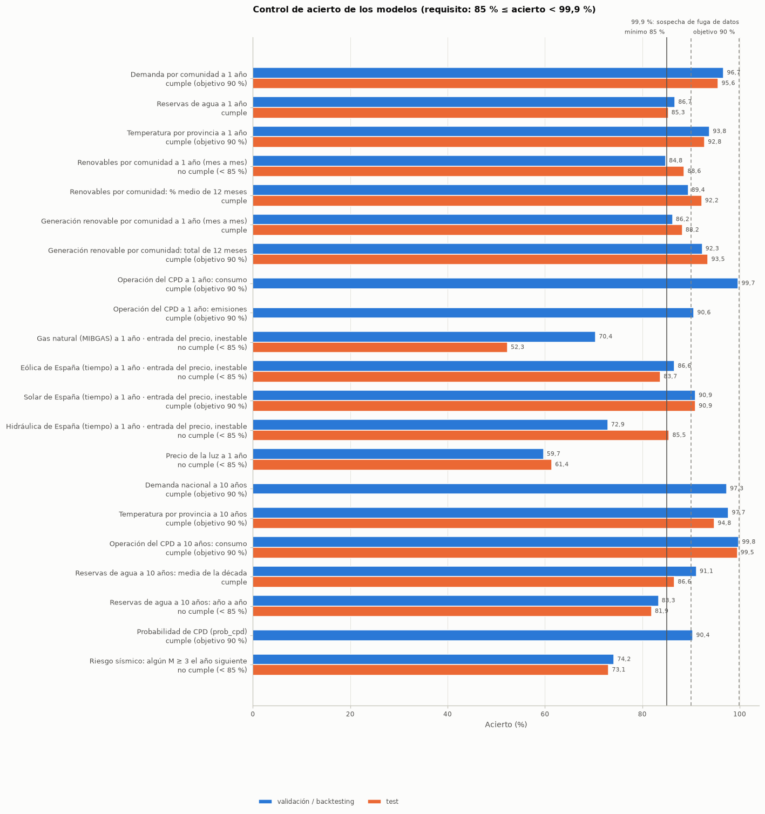

| Modelo | Acierto validación / backtesting | Acierto test | Cómo se mide | Estado |
|---|---|---|---|---|
| Demanda por comunidad a 1 año | 96,7 % | 95,6 % | 100 − WAPE | cumple (objetivo 90 %) |
| Reservas de agua a 1 año | 86,7 % | 85,3 % | 100 − WAPE | cumple |
| Temperatura por provincia a 1 año | 93,8 % | 92,8 % | 100 − WAPE (en °C) | cumple (objetivo 90 %) |
| Renovables por comunidad a 1 año (mes a mes) | 84,8 % | 88,6 % | 100 − WAPE | no cumple (< 85 %) |
| Renovables por comunidad: % medio de 12 meses | 89,4 % | 92,2 % | 100 − WAPE de la media anual | cumple |
| Generación renovable por comunidad a 1 año (mes a mes) | 86,2 % | 88,2 % | 100 − WAPE (MWh) | cumple |
| Generación renovable por comunidad: total de 12 meses | 92,3 % | 93,5 % | 100 − WAPE del total anual | cumple (objetivo 90 %) |
| Operación del CPD a 1 año: consumo | 99,7 % | — | 100 − WAPE del total anual (22 orígenes comunes) | cumple (objetivo 90 %) |
| Operación del CPD a 1 año: emisiones | 90,6 % | — | 100 − WAPE del total anual (22 orígenes comunes) | cumple (objetivo 90 %) |
| Atracción empresarial: sociedades creadas a 1 año (mes a mes) | 87,9 % | 84,6 % | 100 − WAPE | no cumple (< 85 %) |
| Atracción empresarial: total de 12 meses | 93,4 % | 92,6 % | 100 − WAPE del total anual | cumple (objetivo 90 %) |
| Impacto eléctrico local a 1 año (P2) | 96,1 % | — | 100 − WAPE del % del CPD sobre la demanda de su comunidad | cumple (objetivo 90 %) |
| Gas natural (MIBGAS) a 1 año · entrada del precio, inestable | 70,4 % | 52,3 % | 100 − WAPE | no cumple (< 85 %) |
| Eólica de España (tiempo) a 1 año · entrada del precio, inestable | 86,6 % | 83,7 % | 100 − WAPE | no cumple (< 85 %) |
| Solar de España (tiempo) a 1 año · entrada del precio, inestable | 90,9 % | 90,9 % | 100 − WAPE | cumple (objetivo 90 %) |
| Hidráulica de España (tiempo) a 1 año · entrada del precio, inestable | 72,9 % | 85,5 % | 100 − WAPE | no cumple (< 85 %) |
| Precio de la luz a 1 año | 59,7 % | 61,4 % | 100 − WAPE | no cumple (< 85 %) |
| Demanda nacional a 10 años | 97,3 % | — | 100 − WAPE (backtesting 2012-2025) | cumple (objetivo 90 %) |
| Temperatura por provincia a 10 años | 97,7 % | 94,8 % | 100 − WAPE (en °C; test desde 2015) | cumple (objetivo 90 %) |
| Operación del CPD a 10 años: consumo | 99,8 % | 99,5 % | 100 − WAPE (temperatura prevista → PUE → consumo) | cumple (objetivo 90 %) |
| Reservas de agua a 10 años: media de la década | 91,1 % | 86,6 % | 100 − WAPE de la media de los 10 años | cumple |
| Reservas de agua a 10 años: año a año | 83,3 % | 81,9 % | 100 − WAPE de cada año | no cumple (< 85 %) |
| Probabilidad de CPD (prob_cpd) | 90,4 % | — | accuracy fuera de pliegue | cumple (objetivo 90 %) |
| Riesgo sísmico: algún M ≥ 3 el año siguiente | 74,2 % | 73,1 % | accuracy (validación 2018-2024, test 2025) | no cumple (< 85 %) |

**No cumplen:** Renovables por comunidad a 1 año (mes a mes) (no cumple (< 85 %)); Atracción empresarial: sociedades creadas a 1 año (mes a mes) (no cumple (< 85 %)); Gas natural (MIBGAS) a 1 año · entrada del precio, inestable (no cumple (< 85 %)); Eólica de España (tiempo) a 1 año · entrada del precio, inestable (no cumple (< 85 %)); Hidráulica de España (tiempo) a 1 año · entrada del precio, inestable (no cumple (< 85 %)); Precio de la luz a 1 año (no cumple (< 85 %)); Reservas de agua a 10 años: año a año (no cumple (< 85 %)); Riesgo sísmico: algún M ≥ 3 el año siguiente (no cumple (< 85 %)). Sus previsiones se enseñan solo como escenario, con el aviso, y no se usan como dato en el simulador.

## Cómo se ha buscado el menor error

1. **Backtesting a 1 año con 24 orígenes** (dos años). En cada origen, cada modelo se entrena solo con lo que se sabía
   entonces y prevé los 12 meses siguientes. Se compara con lo que pasó. Así el error medido es el de una previsión a
   1 año de verdad, y no el de un único periodo.
2. **Candidatos:** baselines (mismo mes del año anterior, último mes, media de 12 meses), un modelo estadístico de
   series temporales (**ETS de Holt-Winters** con tendencia amortiguada, `statsmodels`), modelos de ML (Ridge con
   lags; para el precio, **Ridge con el gas** y gradient boosting) y la **combinación** (media) de los 3 mejores.
3. **Fuente nueva para el precio:** el precio del gas de **MIBGAS** (spot y futuros a 1 trimestre y 1 año), porque el
   gas marca el precio de la luz en muchas horas y sus futuros son lo que el mercado espera para el año siguiente.
4. **Elección:** la combinación, salvo que un modelo solo la mejore en validación en más de un 5 %. Combinar modelos
   reduce el error porque cada uno se equivoca en momentos distintos (recomendación, no viene de clase).
5. **Test:** un año entero que ningún modelo ha visto (origen 2025-10 en el precio y 2025-06 en la
   demanda).

**Transparencia.** La primera versión usaba 12 orígenes de validación y elegía el mejor modelo sin margen: en el
precio eligió el gradient boosting, que luego fue el peor en test (prevía 285 €/MWh extrapolando la crisis de 2022).
Se amplió la validación a 24 orígenes y se fijó la regla de la combinación **después de ver ese test**, así que los
resultados de test son orientativos y no una prueba totalmente independiente.

## Precio de la luz

**Figura 1.** Arriba, el precio real desde 2021 (azul), lo que el modelo habría previsto hace un año (punteado), la
previsión de los próximos 12 meses (naranja) con su intervalo mensual (10-90 %) y la media de 12 meses que usa el
simulador (gris). Abajo, en su propio eje, el gas de MIBGAS (mercado diario y futuro a 1 año) que usan los modelos con gas.

| Modelo | Validación (€/MWh) | Test (€/MWh) |
|---|---|---|
| Precio estructural con el gas y el tiempo previstos (en la combinación) | 27,6 | 38,8 |
| Combinación de los 3 mejores **(elegido)** | 28,5 | 31,1 |
| ETS (Holt-Winters amortiguado) (en la combinación) | 31,2 | 27,8 |
| Último valor (naive) (en la combinación) | 32,0 | 34,0 |
| Ridge con gas (ML) | 32,5 | 36,2 |
| Gradient boosting (ML) | 39,6 | 40,5 |
| Media de los últimos 12 meses (la del simulador) | 42,4 | 33,4 |
| Mismo mes del año anterior (estacional) | 44,5 | 43,4 |
| Ridge (ML) | 45,5 | 38,0 |

Validación: orígenes 2022-11 a 2024-10 (24 orígenes), meses 2022-12 a 2025-10. Test: meses 2025-11 a 2026-10.

**Resultado.** Modelo elegido: **Combinación de los 3 mejores**
(Precio estructural con el gas y el tiempo previstos, ETS (Holt-Winters amortiguado), Último valor (naive)). Error medio a 1 año: 28,5 €/MWh en
validación y 31,1 €/MWh en test, frente a 42,4 y
33,4 €/MWh de la media de 12 meses que usa el simulador.

**Previsión** desde 2026-10: media de **152 €/MWh** para los próximos 12 meses (rango
102-270 €/MWh, cuantiles 10-90 % del error de la media anual en validación), frente a
80 €/MWh de media del último año y 167 €/MWh en 2026-10. El futuro de gas a
1 año cotiza a 68,8 €/MWh. Mes a mes (€/MWh): 2026-11: 162, 2026-12: 164, 2027-01: 160, 2027-02: 142, 2027-03: 137, 2027-04: 130, 2027-05: 134, 2027-06: 152, 2027-07: 157, 2027-08: 159, 2027-09: 161, 2027-10: 164.

**Figura 2.** Las 24 previsiones a 1 año de validación frente al precio real: se ve cuándo acierta y cuándo no
(la previsión tarda en reaccionar a los cambios bruscos).

**¿Por qué no llega al 85 %?** El acierto cae con la antelación: 75 % a 1 mes y
52 % a 12 meses (modelo elegido, validación). Ni el mejor modelo a 1 mes vista
—ETS (Holt-Winters amortiguado)— pasa del 77 %. En los meses de validación el precio real fue de
14 €/MWh (04/2024) a 133 €/MWh (02/2023): el error medio del modelo elegido,
28 €/MWh, es pequeño en un mes caro y enorme en uno barato. Llegar al 85 % exigiría escoger un periodo
de evaluación tranquilo o usar información que no se sabía en el origen, que es lo que el requisito (D8) quiere evitar.
Por eso esta previsión se enseña como **escenario orientativo**, con aviso, y el simulador sigue usando la media de
12 meses como supuesto (D7). Los futuros de electricidad (OMIP) podrían mejorar los primeros meses, pero no se han
integrado y no aseguran el 85 % (mejora posible; recomendación, no viene de clase).

## Gas y tiempo: modelos añadidos para el precio de la luz (inestables)

El precio de la luz era el modelo más difícil: se quedaba en un 59-62 % de acierto. Como el precio lo marca casi
siempre la central de gas de ciclo combinado y baja cuando hay mucho viento, sol o agua, se añadieron (18/11/2026)
los **modelos del gas** (MIBGAS: último valor, ETS y los futuros del gas) y **del tiempo**, a través de la generación
eólica, solar e hidráulica de España (REData; la hidráulica, también con la reserva de los embalses). Con ellos se
construye un **precio estructural**: log(precio) = f(log(gas), cuotas de eólica, solar, hidráulica, nuclear, ciclo
combinado y carbón, ciclo combinado × gas, mes), ajustado con los meses reales y alimentado con las previsiones.

**Son inestables:** el gas y el tiempo de dentro de un año no se pueden saber, y sus aciertos cambian mucho entre
validación y test. Se usan solo como entradas del precio, no como dato del simulador.

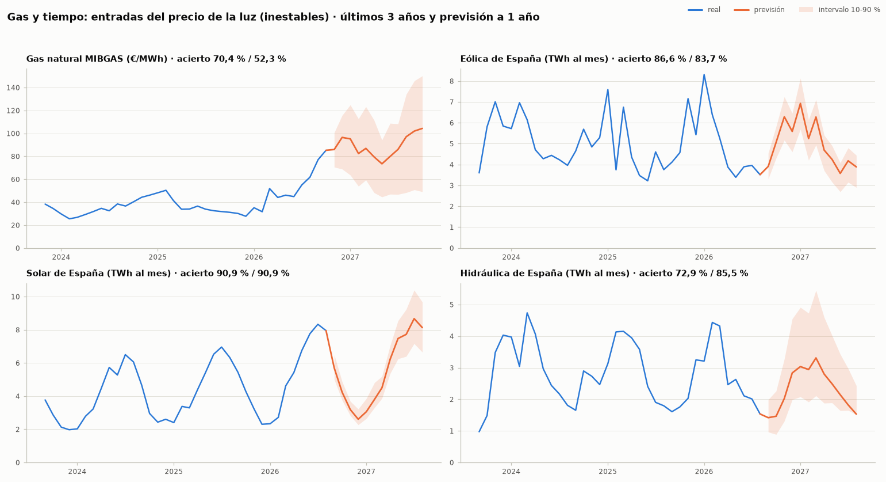

**Figura 2b.** Gas y generación eólica, solar e hidráulica de España: últimos 3 años y previsión a 1 año, con su
acierto (validación / test).

| Modelo | Elegido | Acierto validación | Acierto test |
|---|---|---|---|
| Gas natural (MIBGAS) | ETS (Holt-Winters amortiguado) | 70,4 % | 52,3 % |
| Eólica de España | Combinación de los 3 mejores | 86,6 % | 83,7 % |
| Solar de España | ETS de 5 años sobre el logaritmo | 90,9 % | 90,9 % |
| Hidráulica de España | Combinación de los 3 mejores | 72,9 % | 85,5 % |

**Resultado para la luz.** Como candidato del precio, el **precio estructural** acierta un 60,9 % en validación y un 51,8 % en test y entra en la combinación. El acierto del precio queda en 59,7 % en validación y
61,4 % en test. **Diagnóstico:** aun con el gas y la generación **reales** de cada mes (sin previsión), el
precio solo se explica en un 78,9 %: faltan datos que no son abiertos o no son mensuales, como el precio del CO2 (la
fuente de la bolsa EEX es de pago), la demanda hora a hora y las interconexiones. Por eso el precio sigue como
orientativo.

## Demanda eléctrica por comunidad autónoma

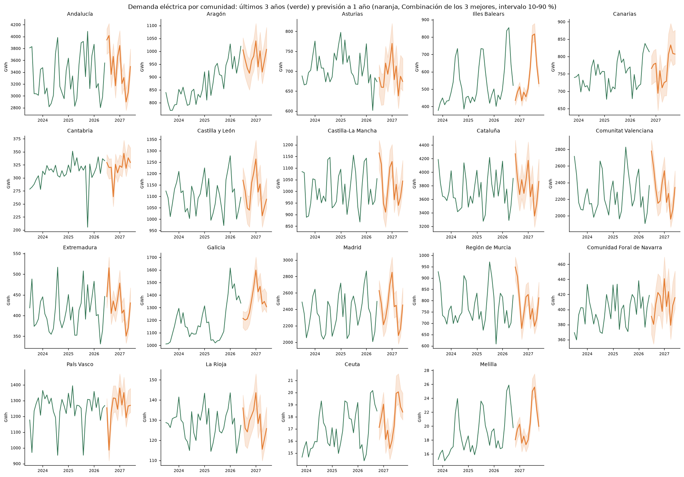

**Figura 3.** Últimos 3 años y previsión a 1 año de cada comunidad, con su intervalo (10-90 %).

| Modelo | Validación (% MAPE) | Test (% MAPE) |
|---|---|---|
| ETS (Holt-Winters amortiguado) (en la combinación) | 3,76 | 5,28 |
| Combinación de los 3 mejores **(elegido)** | 3,90 | 4,39 |
| Mismo mes del año anterior (estacional) (en la combinación) | 4,54 | 4,88 |
| Ridge (ML) (en la combinación) | 4,55 | 4,70 |
| Mismo mes del año anterior × tendencia | 5,82 | 4,98 |

Validación: orígenes 2022-07 a 2024-06 (24 orígenes), meses 2022-08 a 2025-06. Test: meses 2025-07 a 2026-06.

**Resultado.** Modelo elegido: **Combinación de los 3 mejores**
(ETS (Holt-Winters amortiguado), Mismo mes del año anterior (estacional), Ridge (ML)). Error medio a 1 año: 3,90 % en validación y
4,39 % en test, frente a 4,88 % del mejor
baseline en test («mismo mes del año anterior»).

| Comunidad | Último año (GWh) | Previsión 1 año (GWh) | Variación | Rango (GWh) | Datos hasta |
|---|---|---|---|---|---|
| Cataluña | 45.353 | 45.689 | 0,7 % | 44.641-46.190 | 2026-06 |
| Andalucía | 41.573 | 41.628 | 0,1 % | 40.232-42.252 | 2026-06 |
| Madrid | 28.956 | 29.206 | 0,9 % | 28.238-30.125 | 2026-06 |
| Comunitat Valenciana | 27.718 | 27.769 | 0,2 % | 26.778-28.139 | 2026-06 |
| Galicia | 15.599 | 16.191 | 3,8 % | 15.125-17.334 | 2026-06 |
| País Vasco | 14.876 | 15.068 | 1,3 % | 14.612-15.186 | 2026-06 |
| Castilla y León | 13.336 | 13.437 | 0,8 % | 13.026-13.696 | 2026-06 |
| Castilla-La Mancha | 12.243 | 12.329 | 0,7 % | 11.855-12.817 | 2026-06 |
| Aragón | 11.369 | 11.635 | 2,3 % | 11.148-12.142 | 2026-06 |
| Región de Murcia | 9.359 | 9.416 | 0,6 % | 9.013-9.731 | 2026-06 |
| Canarias | 9.137 | 9.197 | 0,7 % | 9.163-9.636 | 2026-10 |
| Asturias | 8.259 | 8.300 | 0,5 % | 7.839-8.601 | 2026-06 |
| Illes Balears | 6.659 | 6.726 | 1,0 % | 6.517-6.932 | 2026-10 |
| Extremadura | 5.081 | 5.100 | 0,4 % | 4.839-5.179 | 2026-06 |
| Comunidad Foral de Navarra | 4.838 | 4.886 | 1,0 % | 4.567-4.975 | 2026-06 |
| Cantabria | 3.741 | 3.846 | 2,8 % | 3.673-4.143 | 2026-06 |
| La Rioja | 1.539 | 1.550 | 0,7 % | 1.467-1.568 | 2026-06 |
| Melilla | 238 | 243 | 1,9 % | 242-262 | 2026-10 |
| Ceuta | 209 | 213 | 2,1 % | 203-229 | 2026-10 |

Rango: cuantiles 10-90 % del error de la suma anual de cada comunidad en validación.

## Reservas de agua por ámbito hidrográfico (riesgo hídrico, P4)

Reserva de los embalses (% de la capacidad) de los 16 ámbitos del Boletín Hidrológico (MITECO, desde 1987), mes a
mes, 1 año vista. Candidatos: se mantiene el último mes, mismo mes del año anterior, **climatología** (media del mes en
los 10 años anteriores), **anomalía persistente** (climatología + la anomalía actual, que se va diluyendo con un factor
φ por horizonte ajustado con los años anteriores), la misma con un **φ propio de cada cuenca**, y ETS. Se probó también
la lluvia reciente de la cuenca (NASA POWER): no mejoraba y se descartó.

**Transparencia.** El candidato con φ por cuenca se añadió después de una primera ejecución en la que la combinación
elegida (con «último mes») no llegaba al 85 % en test. La elección sigue siendo con la validación, pero el test de las
reservas ya no es del todo independiente, y su acierto (85,3 %) está justo en el mínimo.

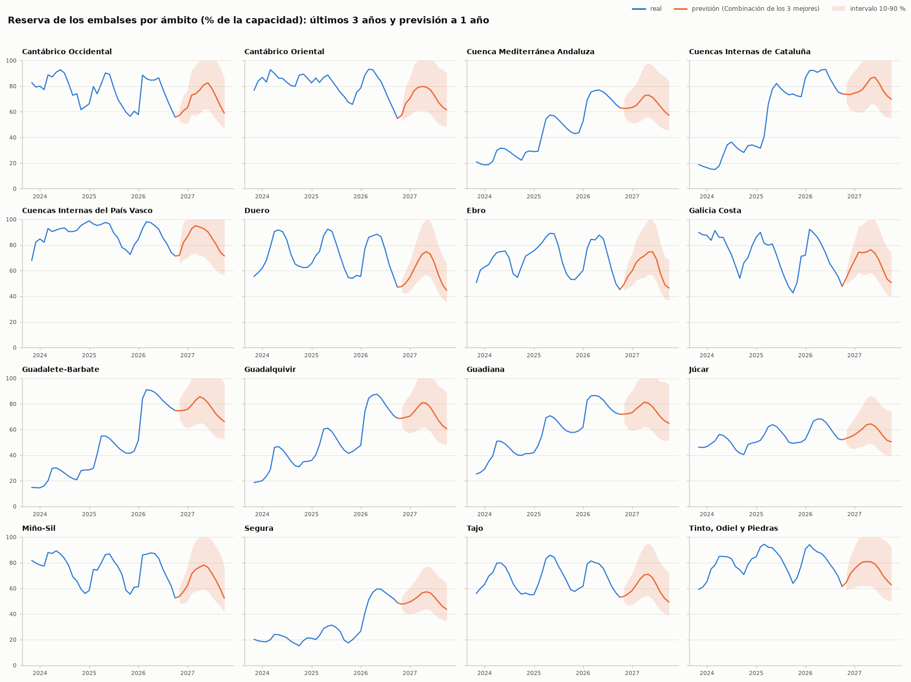

**Figura 4.** Últimos 3 años y previsión a 1 año de cada ámbito.

| Modelo | Acierto validación | Acierto test | MAE test (puntos) |
|---|---|---|---|
| Combinación de los 3 mejores **(elegido)** | 86,7 % | 85,3 % | 10,5 |
| Anomalía persistente (φ común) (en la combinación) | 86,3 % | 84,6 % | 10,9 |
| Anomalía persistente (φ de cada cuenca) (en la combinación) | 86,0 % | 84,9 % | 10,8 |
| ETS (Holt-Winters amortiguado) (en la combinación) | 85,1 % | 84,5 % | 11,0 |
| Último valor (naive) | 82,0 % | 74,4 % | 18,2 |
| Mismo mes del año anterior (estacional) | 80,3 % | 81,8 % | 12,9 |
| Climatología (media del mes en los años anteriores) | 75,7 % | 80,4 % | 13,9 |

Validación: orígenes 2022-11 a 2024-10 (24 orígenes). Test: meses 2025-11 a 2026-10. Error en puntos porcentuales de reserva.

## Temperatura media por provincia (PUE)

Temperatura media mensual (°C) de las 52 provincias (NASA POWER, desde 2015), 1 año vista. Es la variable con la que
el simulador estima el PUE (`simulator.pue_estimado`) y, con él, el consumo, el OPEX y el VAN: según el EDA, el VAN
simulado depende casi solo de ella. Candidatos: los mismos que las reservas (último mes, mismo mes del año anterior,
climatología, anomalía persistente con un φ común y con un φ propio de cada provincia, y ETS) y la combinación de los 3
mejores. Como los datos empiezan en 2015, la climatología usa todos los años anteriores al origen (hasta 10) y se exige
un mínimo de 5 años de historia.

**Cómo leer el acierto.** Es 100 − WAPE con la temperatura en °C. El °C no tiene un cero natural, así que ese porcentaje
depende de la escala: con el mismo error, en kelvin saldría un 99,7 %, que parece casi perfecto sin decir nada
nuevo. Por eso la cifra que manda es el **error en °C** (MAE). El intervalo de la previsión también va en °C (aditivo),
no en porcentaje.

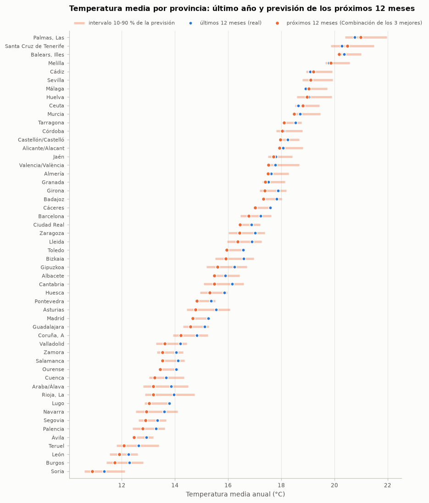

**Figura 5.** Temperatura media de las 52 provincias: el último año real (azul) y la previsión de los próximos 12 meses
(naranja) con su intervalo 10-90 % (barra).

| Modelo | Acierto validación | Acierto test | MAE validación (°C) | MAE test (°C) |
|---|---|---|---|---|
| ETS (Holt-Winters amortiguado) (en la combinación) | 93,8 % | 93,1 % | 0,98 | 1,12 |
| Combinación de los 3 mejores **(elegido)** | 93,8 % | 92,8 % | 0,98 | 1,17 |
| Anomalía persistente (φ de cada provincia) (en la combinación) | 93,5 % | 92,5 % | 1,04 | 1,22 |
| Anomalía persistente (φ común) (en la combinación) | 93,4 % | 92,5 % | 1,05 | 1,21 |
| Climatología (media del mes en los años anteriores) | 93,2 % | 92,4 % | 1,08 | 1,23 |
| Mismo mes del año anterior (estacional) | 92,4 % | 92,9 % | 1,22 | 1,16 |
| Último valor (naive) | 58,1 % | 63,0 % | 6,67 | 6,03 |

Validación: orígenes 2022-11 a 2024-10 (24 orígenes). Test: meses 2025-11 a 2026-10.

**Resultado.** Modelo elegido: **Combinación de los 3 mejores** (ETS (Holt-Winters amortiguado), Anomalía persistente (φ de cada provincia), Anomalía persistente (φ común)).
Error de un mes: 0,98 °C en validación y 1,17 °C en test. Error de la media de 12 meses, que es
la que usa el PUE: **0,47 °C** en validación y 0,61 °C en test. Con la fórmula del simulador,
0,47 °C mueven el PUE 0,005 (un PUE de aire es 1,45), poco frente a los 0,101 que separan la
provincia más fría de la más cálida. Previsión: de 10,9 °C en Soria a 21,0 °C en
Palmas, Las; de media, 0,4 °C menos que el último año.

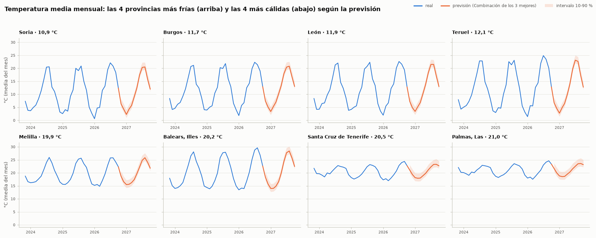

**Figura 6.** Serie mensual de las 4 provincias más frías y las 4 más cálidas según la previsión: últimos 3 años y
previsión a 1 año con su intervalo.

## Generación renovable por comunidad autónoma

Porcentaje de la generación eléctrica de cada comunidad que es renovable (REData, mensual desde 2015), 1 año vista. Un
CPD que quiera energía verde la tendrá más fácil (y más barata) donde la red ya es muy renovable. Ceuta queda fuera: no
tiene generación renovable en todo el periodo. Candidatos: los de las reservas y la temperatura (último mes, mismo mes
del año anterior, climatología, anomalía persistente con φ común y por comunidad, ETS), dos ETS con solo los últimos 5
años (con y sin tendencia) y la combinación de los 3 mejores.

**Transparencia.** Las dos ETS de 5 años se añadieron después de una primera prueba en la que la combinación se
quedaba en un 83,8 % en validación: con tanta potencia solar nueva, la historia larga frena la tendencia. La elección
sigue siendo con la validación. La fila de la media de 12 meses del control de acierto se añadió después de ver que el
mes a mes no llegaba al mínimo; las dos filas se enseñan. El 18/11/2026 se añadió un Ridge sobre anomalías con la
reserva de los embalses (más agua, más hidráulica), elegido también con la validación.

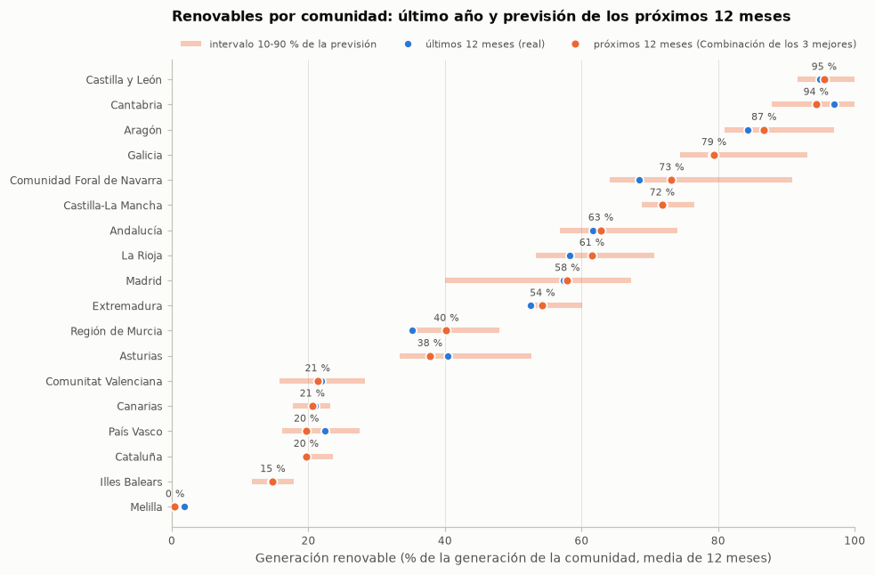

**Figura 7.** % renovable de cada comunidad: el último año real (azul) y la previsión de los próximos 12 meses (naranja)
con su intervalo 10-90 % (barra).

| Modelo | Acierto validación | Acierto test | MAE validación (puntos) | MAE test (puntos) |
|---|---|---|---|---|
| Combinación de los 3 mejores **(elegido)** | 84,8 % | 88,6 % | 7,23 | 5,73 |
| ETS de 5 años sin tendencia (en la combinación) | 84,2 % | 88,7 % | 7,55 | 5,69 |
| ETS de 5 años con tendencia amortiguada (en la combinación) | 84,0 % | 89,1 % | 7,60 | 5,45 |
| Ridge sobre anomalías con la reserva de los embalses (ML) (en la combinación) | 83,7 % | 86,1 % | 7,75 | 6,99 |
| ETS (Holt-Winters amortiguado) | 83,5 % | 89,5 % | 7,85 | 5,27 |
| Anomalía persistente (φ de cada comunidad) | 81,8 % | 88,8 % | 8,66 | 5,63 |
| Anomalía persistente (φ común) | 81,3 % | 87,1 % | 8,89 | 6,45 |
| Mismo mes del año anterior (estacional) | 80,5 % | 88,9 % | 9,26 | 5,56 |
| Último valor (naive) | 79,8 % | 84,8 % | 9,62 | 7,63 |
| Climatología (media del mes en los años anteriores) | 73,8 % | 76,6 % | 12,48 | 11,71 |

Validación: orígenes 2022-09 a 2024-08 (24 orígenes). Test: meses 2025-09 a 2026-08.

**Resultado.** Modelo elegido: **Combinación de los 3 mejores** (ETS de 5 años sin tendencia, ETS de 5 años con tendencia amortiguada, Ridge sobre anomalías con la reserva de los embalses (ML)).
Mes a mes: 84,8 % de acierto en validación y 88,6 % en test (error de 7,2 y
5,7 puntos). **% medio de los 12 meses: 89,4 % en validación y 92,2 % en test.**
Previsión: de 0 % en Melilla a 96 % en Castilla y León; de media,
0,3 puntos más que el último año.

**¿Por qué el mes a mes no llega al 85 %?** El % renovable de un mes depende del viento, la lluvia y el sol de
ese mes, que no se pueden saber con un año de antelación: el acierto baja de 88 % a 1 mes a 84 % a 12 meses. Tres
comunidades suman el 37 % del error de validación: Cantabria (17 %), Comunidad Foral de Navarra (11 %), Madrid (9 %). En las comunidades con poca generación, una sola
central que para o arranca cambia mucho el porcentaje. Los errores de meses sueltos se compensan en la media de 12 meses, que es la cifra que
interesa para un CPD (un contrato de energía renovable es anual): esa sí cumple. El gráfico mes a mes se enseña como
orientativo, con aviso.

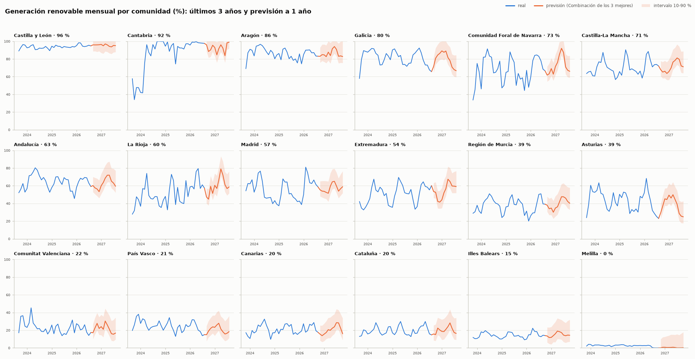

**Figura 8.** % renovable mensual de cada comunidad (de más a menos renovable según la previsión): últimos 3 años y
previsión a 1 año con su intervalo.

## Cobertura renovable por comunidad autónoma

Cuánta energía renovable genera cada comunidad frente a la que consume: **cobertura = generación renovable / demanda**.
Por encima del 100 %, la comunidad genera en renovables más de lo que consume: hay energía verde de sobra para un CPD
nuevo. La generación renovable (MWh, REData) se prevé con los mismos candidatos que el % renovable, una ETS sobre el
logaritmo y, desde el 18/11/2026, la **suma de tecnologías**: solar, eólica, hidráulica y resto se prevén por separado
(cada una con su estacionalidad y su tendencia) y se suman. La demanda, con su propio modelo (arriba). Comunidades por encima del 100 %: Extremadura, Castilla y León, Castilla-La Mancha, Aragón, La Rioja.

| Modelo | Acierto validación (mes a mes) | Acierto test (mes a mes) |
|---|---|---|
| Combinación de los 3 mejores **(elegido)** | 86,2 % | 88,2 % |
| Suma de tecnologías con la hidráulica desde los embalses (en la combinación) | 85,0 % | 87,3 % |
| Suma de tecnologías (ETS de solar, eólica, hidráulica y resto) (en la combinación) | 84,9 % | 87,7 % |
| ETS de 5 años con tendencia amortiguada (en la combinación) | 84,9 % | 86,6 % |
| ETS de 5 años sin tendencia | 84,2 % | 87,3 % |
| ETS de 5 años sobre el logaritmo | 84,1 % | 87,5 % |
| ETS (Holt-Winters amortiguado) | 82,7 % | 86,4 % |
| Anomalía persistente (φ de cada comunidad) | 82,0 % | 84,2 % |
| Mismo mes del año anterior (estacional) | 80,8 % | 84,4 % |
| Anomalía persistente (φ común) | 80,3 % | 86,6 % |
| Último valor (naive) | 72,4 % | 75,5 % |
| Climatología (media del mes en los años anteriores) | 70,0 % | 69,4 % |

Validación: orígenes 2022-09 a 2024-08 (24 orígenes). Test: meses 2025-09 a 2026-08. **Total de 12 meses** (la cifra que entra en
la cobertura): **92,3 %** en validación y **93,5 %** en test. El mes a mes depende del viento, la
lluvia y el sol de cada mes y se enseña solo como orientativo.

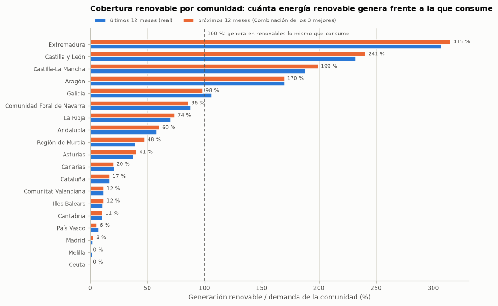

**Figura 9.** Cobertura renovable de cada comunidad: último año real (azul) y previsión de los próximos 12 meses
(naranja). La línea discontinua marca el 100 %. La demanda de la península termina en junio de 2026 (ver limitaciones),
así que los dos periodos de 12 meses no coinciden del todo.

| Comunidad | Renovable último año (GWh) | Demanda último año (GWh) | Cobertura último año | Cobertura prevista |
|---|---|---|---|---|
| Extremadura | 15.615 | 5.081 | 307 % | 298 % |
| Castilla y León | 30.956 | 13.336 | 232 % | 227 % |
| Castilla-La Mancha | 23.002 | 12.243 | 188 % | 195 % |
| Aragón | 19.320 | 11.369 | 170 % | 160 % |
| La Rioja | 1.084 | 1.539 | 70 % | 143 % |
| Comunidad Foral de Navarra | 4.249 | 4.838 | 88 % | 86 % |
| Galicia | 16.562 | 15.599 | 106 % | 85 % |
| Andalucía | 24.116 | 41.573 | 58 % | 61 % |
| Región de Murcia | 3.689 | 9.359 | 39 % | 44 % |
| Asturias | 3.118 | 8.259 | 38 % | 31 % |
| Canarias | 1.922 | 9.137 | 21 % | 20 % |
| Cataluña | 7.808 | 45.353 | 17 % | 14 % |
| Illes Balears | 739 | 6.659 | 11 % | 11 % |
| Comunitat Valenciana | 3.270 | 27.718 | 12 % | 11 % |
| Cantabria | 403 | 3.741 | 11 % | 9 % |
| País Vasco | 1.105 | 14.876 | 7 % | 5 % |
| Madrid | 763 | 28.956 | 3 % | 3 % |
| Ceuta | 0 | 209 | 0 % | 0 % |
| Melilla | 4 | 238 | 2 % | 0 % |

## Operación del CPD a 1 año (sostenibilidad operativa, objetivo A3)

Encadena los modelos anteriores con las fórmulas del simulador para un CPD de referencia (50 MW de TI,
carga 80 %, refrigeración por aire): la **temperatura media prevista** de la provincia da el
PUE y el consumo, y el **% renovable previsto** de su comunidad da las emisiones si el CPD se abastece con el mix de
generación de esa comunidad (0,10 t CO2 por MWh no renovable). El mercado eléctrico es único, así que
usar el mix de la comunidad es una aproximación (recomendación, no viene de clase). También se da la reserva mínima
prevista de los embalses del ámbito en los próximos 12 meses.

**Validación de punta a punta** (22 orígenes de validación comunes a los dos modelos, 51 provincias): el consumo
del año siguiente calculado con lo previsto acierta un **99,7 %** y las emisiones un **90,6 %**. El
consumo acierta tanto porque el PUE apenas cambia con la temperatura en la fórmula del simulador (de 1,409 a 1,510
entre provincias); no hay fuga de información: el dato real de cada año no se usa para prever ese año.

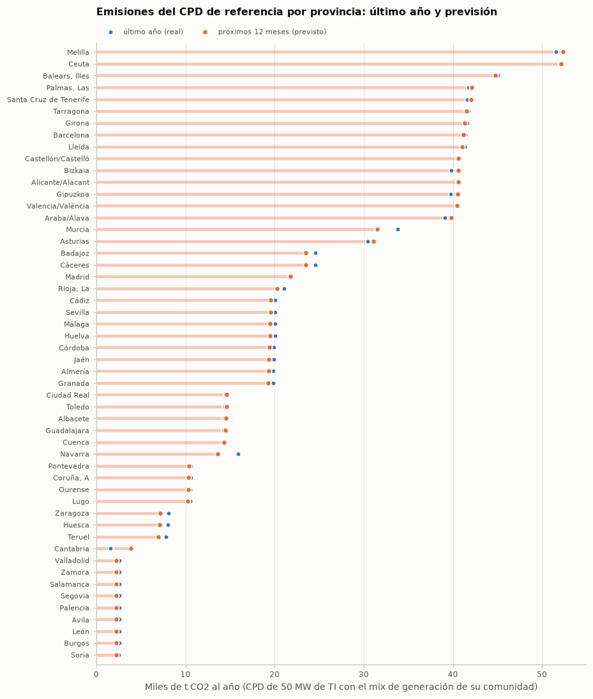

**Figura 10.** Emisiones anuales del CPD de referencia en cada provincia: último año (azul) y próximos 12 meses
(naranja).

Menos emisiones previstas: Soria (2,2 mil t), Burgos (2,2 mil t), León (2,2 mil t), Ávila (2,2 mil t), Palencia (2,2 mil t). Más: Melilla (52,3 mil t), Ceuta (52,1 mil t), Balears, Illes (44,8 mil t), Palmas, Las (42,1 mil t), Santa Cruz de Tenerife (42,0 mil t).

## Impacto del CPD sobre los recursos locales (pregunta P2)

No hay consumo eléctrico ni de agua abierto por municipio o provincia, así que el impacto del CPD de referencia se mide
frente a lo que sí se publica por **comunidad**. Código: `src/cpd/modelos/impacto_local.py`.

- **Electricidad:** consumo previsto del CPD en los próximos 12 meses (temperatura prevista → PUE) frente a la demanda
  prevista de su comunidad (modelo de demanda).
- **Red:** potencia máxima del CPD (potencia TI × PUE) frente a la capacidad de acceso **libre** para nueva demanda en su
  comunidad (Red Eléctrica).
- **Agua:** agua anual del CPD frente al agua registrada y distribuida por la red pública de su comunidad (INE,
  «Estadística sobre el suministro y saneamiento del agua», 2024; dato nuevo, tabla 53447). Ceuta y Melilla se
  publican juntas.
- **Habitantes equivalentes:** consumo del CPD entre el consumo por habitante de su comunidad (todos los usos: hogares,
  industria y servicios). Es una comparación de escala, no un número de hogares.

**Validación de punta a punta** del % eléctrico (20 orígenes de validación comunes a los modelos de temperatura y
demanda): acierto **96,1 %** en validación.

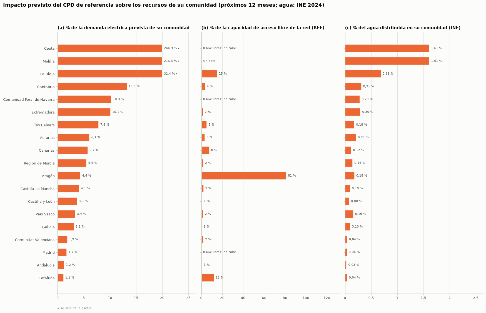

**Figura 17.** Impacto previsto del CPD de referencia por comunidad (media de sus provincias). Las barras que se salen
de la escala llevan «▸».

En la provincia mediana el CPD supondría el **3,7 %** de la electricidad de su comunidad (como
90.453 habitantes) y el **0,10 %** de su agua (como 2.563 habitantes): el recurso que más
pesa es la electricidad, no el agua. Mayor peso eléctrico: Ceuta (244,9 %), Melilla (216,3 %), Rioja, La (32,4 %), Cantabria (13,3 %) (sistemas pequeños o aislados).
Red casi llena (≥ 50 % de la capacidad libre): Zaragoza (82 %), Huesca (82 %), Teruel (80 %). Sin capacidad libre (0 MW):
Madrid, Navarra, Ceuta; ahí el CPD no cabe hoy en la red de acceso de su comunidad.

## Atracción empresarial (E42)

Indicador con datos reales: **sociedades mercantiles constituidas** cada mes en cada provincia (INE, Estadística de
Sociedades Mercantiles, tabla 6295, desde 2008; dato nuevo, último mes 2025-12). Se prevén los 12 meses siguientes con el
mismo protocolo que el resto (24 orígenes de validación, test de un año, combinación salvo mejora clara) y los mismos
candidatos que la generación renovable en MWh. Para comparar provincias se expresa **por cada 10.000 habitantes**. Es un
indicador de dinamismo empresarial (recomendación, no viene de clase): no mide qué empresas llegan por el CPD. Código:
`src/cpd/modelos/empresas.py`.

Elegido: **ETS (Holt-Winters amortiguado)** (mejora a la combinación en más de un 5 % en validación). Mes a mes acierta
87,9 % en validación y 84,6 % en test (el mes suelto es ruidoso: orientativo si baja del 85 %); el **total de
12 meses**, que es el indicador, acierta **93,4 %** y **92,6 %**.

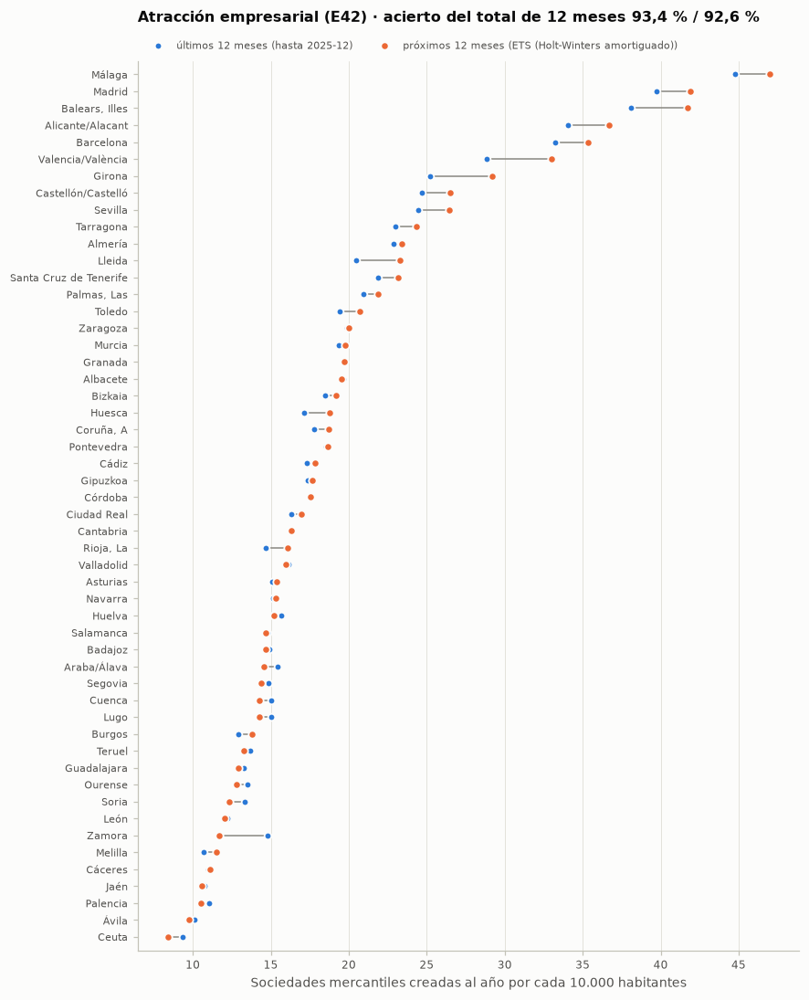

**Figura 20.** Sociedades creadas al año por cada 10.000 habitantes: últimos 12 meses (azul) y próximos 12 (naranja).

España: 127.560 sociedades en los últimos 12 meses y 134.656 previstas. Más dinamismo por habitante: Málaga (47,0), Madrid (41,9), Balears, Illes (41,7), Alicante/Alacant (36,7);
menos: Ceuta (8,4), Ávila (9,7), Palencia (10,5).

## Riesgo sísmico por provincia (P8)

¿Habrá al menos un terremoto de magnitud ≥ 3 en la provincia el año que viene? Datos de EMSC por provincia y año
(desde 2015); cada año se entrena solo con los anteriores. Variables: si lo hubo el año anterior, en qué fracción de
años lo ha habido, actividad media, magnitud máxima y la peligrosidad oficial de la norma NCSE-02 (aceleración
máxima de la provincia y municipios con ab ≥ 0,08 g). Candidatos: clase mayoritaria, persistencia («como el año
anterior») y regresión logística; se elige con la log-loss de validación (2018-2024; test 2025).

| Modelo | Partición | Accuracy | ROC-AUC | Recall | Log-loss |
|---|---|---|---|---|---|
| Logística con todas las features (ML) **(elegido)** | validacion | 74,2 % | 0,82 | 75 % | 0,549 |
| Clase mayoritaria (baseline) | validacion | 62,9 % | 0,55 | 0 % | 0,662 |
| Persistencia (como el año anterior) | validacion | 71,7 % | 0,70 | 65 % | 1,121 |
| Logística con todas las features (ML) **(elegido)** | test | 73,1 % | 0,80 | 75 % | 0,524 |
| Clase mayoritaria (baseline) | test | 76,9 % | 0,50 | 0 % | 0,589 |
| Persistencia (como el año anterior) | test | 75,0 % | 0,66 | 50 % | 0,993 |

**No llega al 85 %** aunque mejora a los baselines (ROC-AUC 0,82): que haya o no un terremoto de magnitud ≥ 3 en un año es muy aleatorio y diez años de catálogo son poca historia. No se usa en el score. Para el riesgo sísmico del score y del filtro se usa directamente la aceleración sísmica básica oficial de la capital (NCSE-02), que es el dato que manda para proyectar un edificio.
Probabilidades más altas para 2026: Granada (97 %), Málaga (94 %), Murcia (90 %), Alicante/Alacant (88 %), Santa Cruz de Tenerife (84 %).

## Demanda eléctrica nacional a 10 años (P5)

Demanda anual de España (REData, 2007-2025). Backtesting plurianual: desde el final de cada año entre 2011 y
2024, cada modelo prevé los 10 años siguientes (o los que haya). Candidatos: sin cambio, media de 3 años,
deriva, tendencia lineal, Holt amortiguado y la combinación de los 3 mejores.

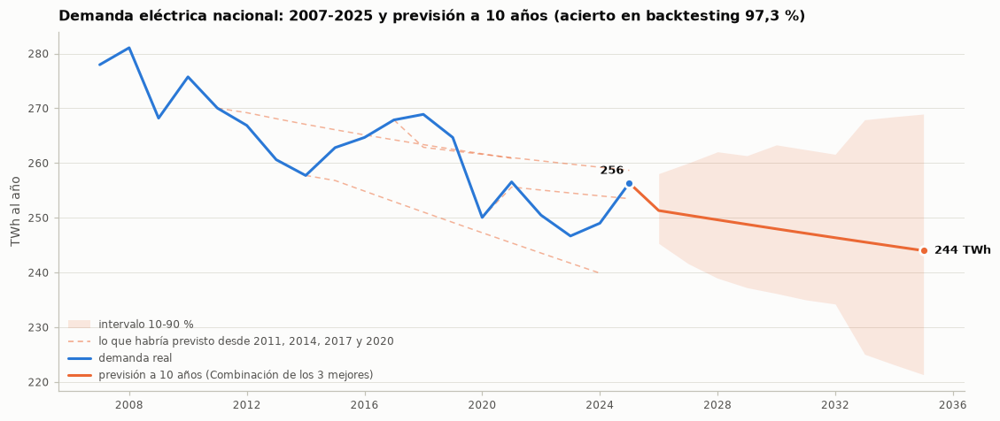

**Figura 11.** Demanda real, lo que el modelo habría previsto desde varios años del pasado y la previsión a 10 años.

MAPE por horizonte (cuantos más años vista, menos orígenes con los que medirlo):

| Años vista | Orígenes | Combinación de los 3 mejores | Holt con tendencia amortiguada | Tendencia lineal | Sin cambio (último año) |
|---|---|---|---|---|---|
| 1 | 14 | 1,9 % | 2,3 % | 2,2 % | 1,9 % |
| 2 | 13 | 2,8 % | 3,2 % | 2,9 % | 2,7 % |
| 3 | 12 | 3,3 % | 3,7 % | 3,1 % | 3,2 % |
| 4 | 11 | 3,3 % | 3,9 % | 3,1 % | 3,3 % |
| 5 | 10 | 3,2 % | 3,6 % | 3,6 % | 4,1 % |
| 6 | 9 | 3,1 % | 3,9 % | 3,5 % | 3,8 % |
| 7 | 8 | 2,4 % | 3,4 % | 3,3 % | 3,8 % |
| 8 | 7 | 1,8 % | 2,3 % | 3,8 % | 4,4 % |
| 9 | 6 | 1,9 % | 3,3 % | 4,5 % | 4,9 % |
| 10 | 5 | 2,2 % | 4,0 % | 5,4 % | 4,7 % |

**Resultado.** Modelo elegido: **Combinación de los 3 mejores**
(Holt con tendencia amortiguada, Tendencia lineal, Sin cambio (último año)); acierto en el backtesting **97,3 %**. Previsión:
251 TWh en 2026 y **244 TWh en 2035** (intervalo 10-90 %:
221-269 TWh), frente a 256 TWh en 2025.

**Limitación.** Es una previsión **tendencial**: no incluye la electrificación, el hidrógeno ni los nuevos centros de
datos, que pueden hacer crecer la demanda. Un CPD de 50 MW de TI consume unos 0,46 TWh al año (el 0,2 % de la demanda
nacional). El intervalo a más de 7 años se extrapola (σ·√h) porque hay pocos orígenes para medirlo.

### Escenarios con los nuevos grandes consumos (P5)

La previsión anterior es **tendencial**: no sabe que llegan centros de datos, hidrógeno o industria electrificada. Red
Eléctrica publica la capacidad de acceso a la red de transporte ya **otorgada** a nuevos consumos
(**18.535 MW** en España) y la que está **en trámite** (**23.500 MW**). Usada al 80 % (factor de carga del CPD
de referencia), la otorgada serían **130 TWh al año**: la mitad de la demanda actual (256 TWh en 2025).
Código: `src/cpd/modelos/escenarios.py`.

No hay dato abierto de cuánto de lo otorgado llega a consumir (Red Eléctrica solo publica el último mes), así que se
dan **escenarios** con supuestos a la vista (`config/settings.yaml → escenarios_demanda`, a calibrar; recomendación, no
viene de clase), con la capacidad entrando de forma lineal en 10 años. **No es una previsión con acierto**: el único
modelo validado es el tendencial.

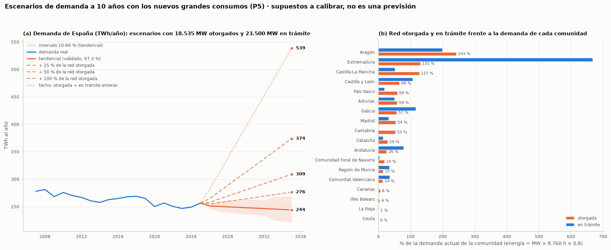

**Figura 11c.** (a) Demanda de España: real, previsión tendencial con su intervalo y escenarios. (b) Energía de la red
otorgada y en trámite de cada comunidad frente a su demanda actual.

En 2035: tendencial 244 TWh (-5 %); con el 25 % de lo otorgado 276 TWh (+8 %); con el 50 % de lo otorgado 309 TWh (+20 %); con el 100 % de lo otorgado 374 TWh (+46 %); techo (otorgada y en trámite enteras)
539 TWh (+110 %). Por comunidad, lo otorgado pesa más en Aragón (243 %), Extremadura (131 %), Castilla-La Mancha (128 %), Castilla y León (66 %): en **Aragón** la red concedida equivale a más de dos veces su
demanda actual, la huella de los centros de datos anunciados allí. La capacidad incluye todos los grandes consumos,
no solo CPD.

## Medio plazo: clima y agua a 10 años (sostenibilidad operativa, objetivo A3)

El objetivo A3 pide previsiones a corto **y medio plazo** de la sostenibilidad operativa del CPD. A 1 año ya están el
PUE, el consumo y las emisiones; a 10 años (2026-2035) lo que cambia la operación es el **clima** (temperatura →
PUE → consumo) y el **agua** de los embalses del ámbito. Código: `src/cpd/modelos/medio_plazo.py`.

**Datos nuevos.** La tabla diaria de clima empieza en 2015 y no basta para validar 10 años. Se añade la temperatura
**mensual de NASA POWER desde 1981** (la misma fuente y el mismo punto que la diaria: en los meses comunes difieren
0,003 °C de media). Las reservas de MITECO ya venían desde 1988.

**Protocolo.** Test: lo que se habría previsto desde 2015 para 2016-2025 (ningún modelo lo ve).
Validación: orígenes 1995-2005 en la temperatura y 1997-2005 en las reservas, cuyos 10 años
previstos terminan antes del test, para que la elección no mire ningún año del test. Candidatos: sin cambio, media de 10
años, media larga (30 años), tendencia lineal de 30 años, media de 10 años más la tendencia, Holt amortiguado y la
combinación de los 3 mejores por MAE de validación.

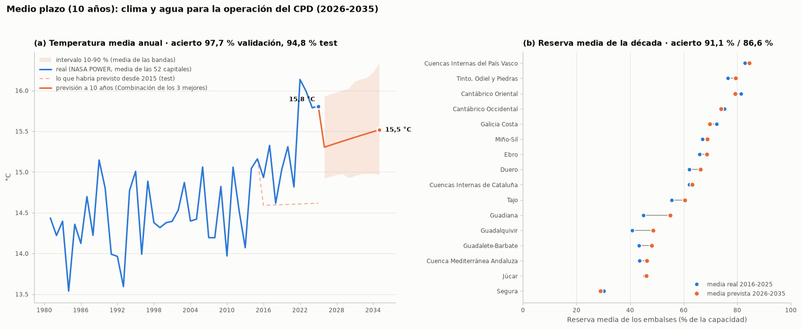

**Figura 11b.** (a) Temperatura media anual de España (media de las 52 capitales): real, lo que se habría previsto
desde 2015 (test) y previsión a 10 años con su intervalo 10-90 %. (b) Reserva media de los embalses de cada
ámbito: últimos 10 años (azul) y próxima década (naranja).

### Temperatura por provincia a 10 años

| Modelo | MAE validación (°C) | MAE test (°C) | Acierto validación | Acierto test |
|---|---|---|---|---|
| Combinación de los 3 mejores **(elegido)** | 0,34 | 0,79 | 97,7 % | 94,8 % |
| Media de 10 años (en la combinación) | 0,34 | 0,79 | 97,6 % | 94,9 % |
| Media larga (30 años) (en la combinación) | 0,34 | 0,89 | 97,6 % | 94,2 % |
| Holt con tendencia amortiguada (en la combinación) | 0,36 | 0,71 | 97,5 % | 95,4 % |
| Tendencia lineal de 30 años | 0,37 | 0,71 | 97,5 % | 95,4 % |
| Media de 10 años + tendencia de 30 | 0,37 | 0,71 | 97,4 % | 95,4 % |
| Sin cambio (último año) | 0,44 | 0,49 | 97,0 % | 96,8 % |

Elegido: **Combinación de los 3 mejores** (Media de 10 años, Media larga (30 años), Holt con tendencia amortiguada). Acierto **97,7 %** en validación y
**94,8 %** en test (error medio 0,34 y 0,79 °C). El test es peor porque 2016-2025 se calentó más
de lo que decía la historia: los modelos con tendencia habrían acertado algo más en el test, pero en la validación (que
es con lo que se elige) no ganaban. Se dice tal cual, sin cambiar la elección: la validación cae en 1996-2015, años
en que la temperatura subió más despacio.

**Sensibilidad (no es la previsión elegida).** Si sigue la tendencia de los últimos 30 años
(0,48 °C por década), la media de España en 2035 sería 16,1 °C en lugar de 15,5 °C (últimos 10
años: 15,4 °C). El PUE medio pasaría de 1,455 a 1,461 y el consumo del CPD subiría un
0,5 % respecto a la última década: el calentamiento afecta poco a la operación con la fórmula del simulador.

**Consumo del CPD a 10 años, de punta a punta** (temperatura prevista → PUE → consumo, frente a lo mismo con la
temperatura real): **99,8 %** en validación y **99,5 %** en test. Es tan alto porque el PUE del simulador
cambia poco con la temperatura; no hay fuga (la temperatura real de cada año no se usa para prever ese año).

Más calor previsto en 2035: Palmas, Las (20,5 °C, PUE 1,50), Santa Cruz de Tenerife (20,1 °C, PUE 1,50), Balears, Illes (19,8 °C, PUE 1,50), Melilla (19,4 °C, PUE 1,49), Cádiz (18,9 °C, PUE 1,49). Menos: Soria (10,3 °C, PUE 1,40), Burgos (11,2 °C, PUE 1,41), León (11,4 °C, PUE 1,41), Teruel (11,7 °C, PUE 1,42), Ávila (11,7 °C, PUE 1,42).

### Reserva de agua por ámbito a 10 años

| Modelo | MAE validación (puntos) | MAE test (puntos) | Acierto validación | Acierto test |
|---|---|---|---|---|
| Combinación de los 3 mejores **(elegido)** | 10,21 | 10,76 | 83,3 % | 81,9 % |
| Media de 10 años (en la combinación) | 10,65 | 10,94 | 82,6 % | 81,5 % |
| Media larga (30 años) (en la combinación) | 10,91 | 9,26 | 82,2 % | 84,4 % |
| Sin cambio (último año) (en la combinación) | 11,66 | 13,56 | 80,9 % | 77,1 % |
| Tendencia lineal de 30 años | 12,95 | 16,20 | 78,8 % | 72,7 % |
| Media de 10 años + tendencia de 30 | 13,16 | 15,34 | 78,5 % | 74,1 % |
| Holt con tendencia amortiguada | 13,40 | 14,10 | 78,1 % | 76,2 % |

Elegido: **Combinación de los 3 mejores** (Media de 10 años, Media larga (30 años), Sin cambio (último año)). **Año a año** acierta 83,3 % en validación y
81,9 % en test: **no llega al 85 %**, porque el año concreto de una sequía no se puede saber con 10 años de
antelación. Para un CPD lo que cuenta en una inversión a 10 años es el **agua media de la década**, y esa sí cumple:
**91,1 %** en validación y **86,6 %** en test. El año a año se enseña como orientativo.

Ámbitos con menos reserva media prevista: Segura (29 %), Júcar (46 %), Cuenca Mediterránea Andaluza (46 %), Guadalete-Barbate (48 %).

**Emisiones a 10 años: no se prevén.** El mix por comunidad solo existe desde 2015 (11 años), con lo que no se puede
validar un horizonte de 10 años; además depende sobre todo de decisiones políticas (PNIEC), no de la historia.

## Impacto socioeconómico: empleo, inversión inducida y PIB (E39-E41)

Modelo **input-output de Leontief (tipo I)** con las **Tablas Input-Output 2022 del INE** (Revisión Estadística 2024;
dato nuevo): la matriz inversa **interior** de Leontief da la producción española que genera cada euro de demanda, y el
empleo (puestos equivalentes a tiempo completo) y el VAB por euro producido de cada rama la pasan a empleos y VAB.
Es el método estándar de la contabilidad nacional para efectos indirectos (recomendación, no viene de clase). Código:
`src/cpd/modelos/socioeconomico.py`.

- **Construcción (una vez):** el CAPEX del CPD de referencia (400 M€) repartido por productos
  (construcciones y trabajos de construcción 35 %, equipo eléctrico 30 %, maquinaria y equipo n.c.o.p. 20 %, servicios técnicos de arquitectura e ingeniería 8 %, servicios de reparación e instalación de maquinaria y equipos 7 %; **supuesto a calibrar** en `config/settings.yaml`). A cada producto se le quita su cuota de importación
  real: de los 400 M€ se quedan en España **295 M€** (la mitad del equipo eléctrico y de la maquinaria se importa).
  Genera **3.402 empleos-año**, 562 M€ de producción (**inversión inducida**, E40) y 217 M€ de VAB.
- **Operación (cada año):** **60 empleos directos** (plantilla del simulador) y **217 indirectos** en los
  proveedores de electricidad, agua y mantenimiento: **277 empleos** (multiplicador ×4,6). VAB directo
  45,2 M€ (ingresos 91,9 M€ − compras 46,7 M€, con las fórmulas del VAN) e indirecto 33,0 M€: **78,2 M€ al año**.
- **PIB (E41):** no hay PIB municipal; el VAB directo se compara con el PIB de cada provincia (INE, Contabilidad
  Regional, 2024). Pesa más en las provincias pequeñas: Melilla (2,46 %), Ceuta (2,32 %), Soria (1,54 %), Ávila (1,15 %); menos en Madrid (0,01 %), Barcelona (0,02 %), Valencia/València (0,06 %).

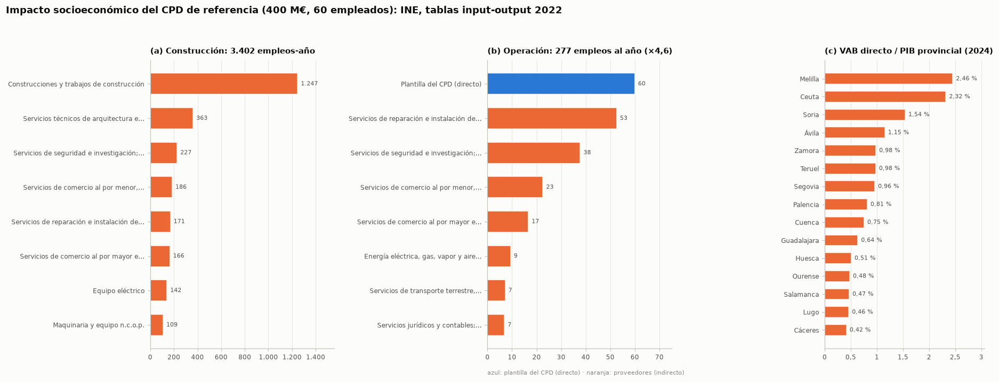

**Figura 18.** (a) Empleo de la construcción por producto (empleos-año). (b) Empleo de un año de operación: plantilla
del CPD (azul) y proveedores (naranja). (c) VAB directo del CPD sobre el PIB de las 15 provincias donde más pesa.

**Límites.** Es un cálculo con coeficientes medios nacionales de 2022, no una previsión: no tiene acierto que medir
con backtesting. Tipo I (no incluye el gasto de los salarios, tipo II). El empleo indirecto y el de la obra se reparten
por toda España (proveedores), así que no se comparan con el paro de la provincia; solo los 60 empleos directos
(en Soria serían el 2,2 % de su paro registrado, 2026-10).

## Errores por horizonte y comparación de modelos

**Figura 12.** Error medio de cada modelo según los meses de antelación (validación), un gráfico por serie. El elegido
va en naranja y el resto en gris.

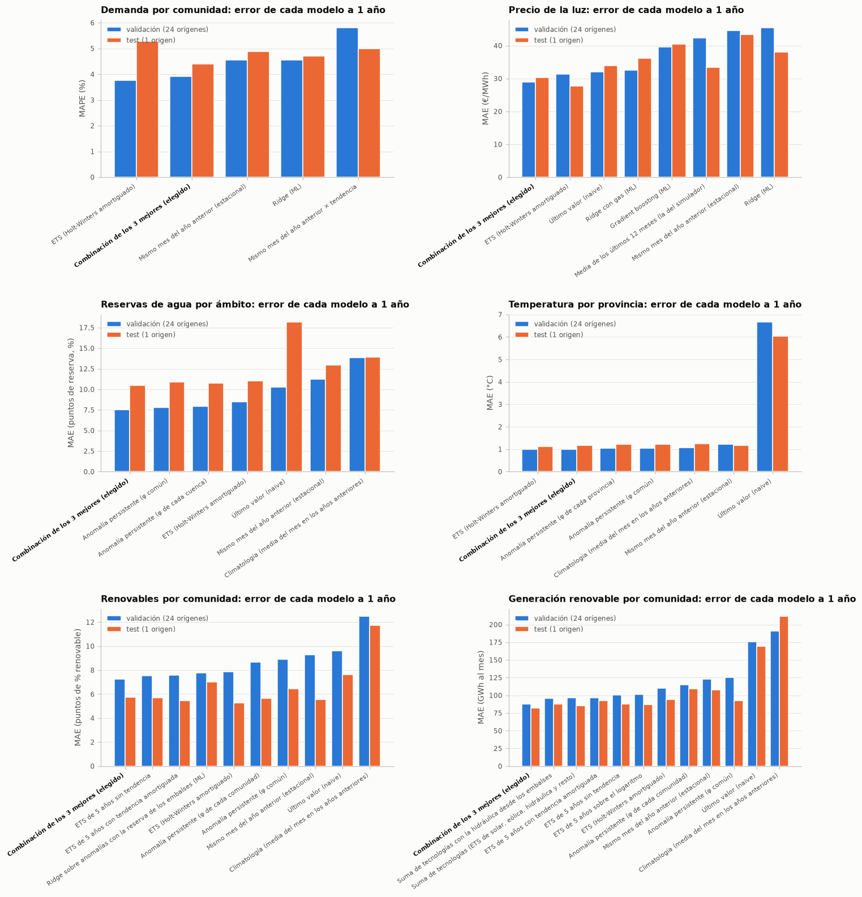

**Figura 13.** Error a 1 año de cada modelo en validación y en test, un gráfico por serie (el elegido, en negrita).

## Limitaciones

- El precio del año siguiente depende sobre todo del gas, el CO2 y la hidráulica, que también se pueden equivocar:
  el intervalo es ancho a propósito. No se han integrado los futuros de electricidad (OMIP), la referencia directa
  del mercado: podrían mejorar los primeros meses, pero no aseguran el acierto mínimo (ver «¿Por qué no llega…?»).
- Un solo año de test por serie: el error de test tiene mucha incertidumbre.
- La demanda peninsular termina en junio de 2026 porque REData aún no ha publicado bien julio y agosto
  (ver [tablas_api.md](../datos/tablas_api.md)): su «año siguiente» empieza en julio de 2026.

## Reproducción

`.\.venv\Scripts\python.exe -m cpd.modelos` (necesita las tablas `gas_diario` y `gas_futuros`, que descarga
`python -m cpd.fuentes.actualizar`). Salidas en `data/curated/modelos/previsiones_1_anio.json` y `anual_*.csv`.
