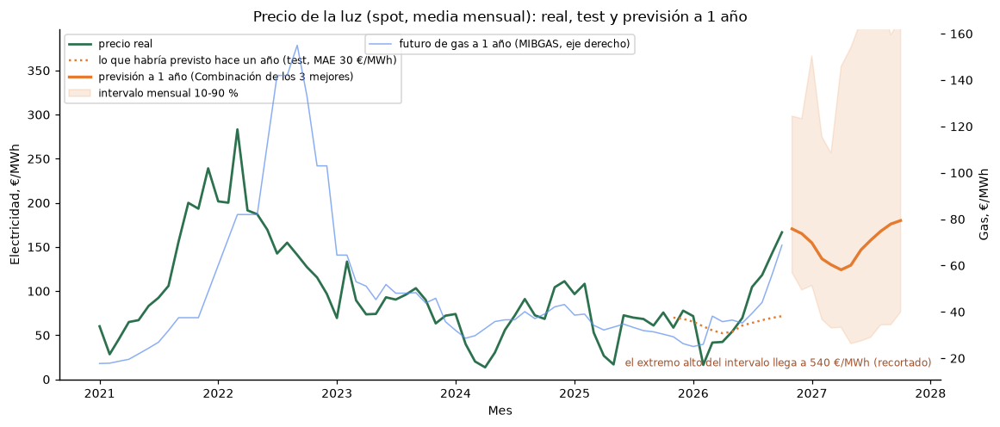
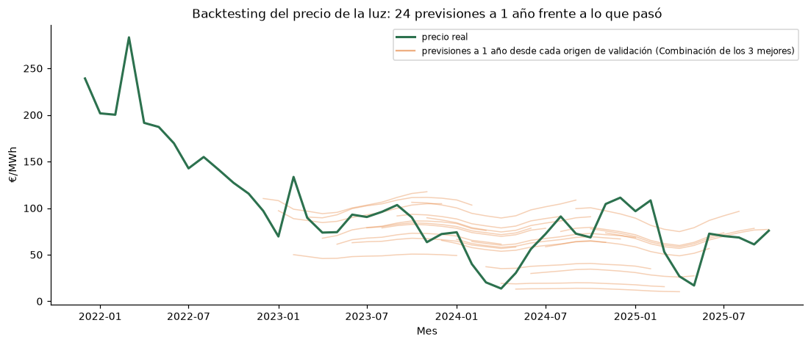
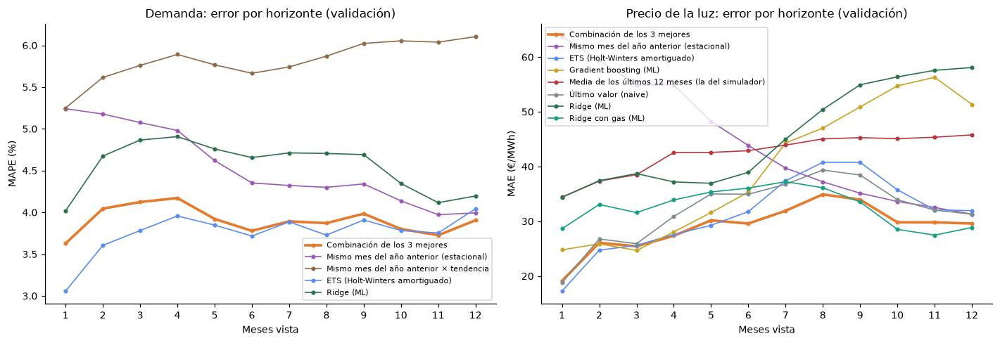

# Previsión a 1 año · demanda eléctrica y precio de la luz

> Generado por `python -m cpd.modelos` el 17/11/2026. No editar a mano: se sobrescribe al volver a ejecutar.

Previsión mes a mes de los **12 meses siguientes** al último dato, con el modelo que menos se equivoca a 1 año.
Código: `src/cpd/modelos/anual.py`. Las fichas de modelo de [demanda](../modelos/demanda_ccaa.md) y
[precio](../modelos/precio_luz.md) describen los modelos a 1 y 12 meses; este informe es el que alimenta el mapa.

## Cómo se ha buscado el menor error

1. **Backtesting a 1 año con 24 orígenes** (dos años). En cada origen, cada modelo se entrena solo con lo que se sabía
   entonces y prevé los 12 meses siguientes. Se compara con lo que pasó. Así el error medido es el de una previsión a
   1 año de verdad, y no el de un único periodo.
2. **Candidatos:** baselines (mismo mes del año anterior, último mes, media de 12 meses), un modelo estadístico de
   series temporales (**ETS de Holt-Winters** con tendencia amortiguada, `statsmodels`), modelos de ML (Ridge con
   lags; para el precio, **Ridge con el gas** y gradient boosting) y la **combinación** (media) de los 3 mejores.
3. **Fuente nueva para el precio:** el precio del gas de **MIBGAS** (spot y futuros a 1 trimestre y 1 año), porque el
   gas marca el precio de la luz en muchas horas y sus futuros son lo que el mercado espera para el año siguiente.
4. **Elección:** la combinación, salvo que un modelo solo la mejore en validación en más de un 5 %. Combinar modelos
   reduce el error porque cada uno se equivoca en momentos distintos (recomendación, no viene de clase).
5. **Test:** un año entero que ningún modelo ha visto (origen 2025-10 en el precio y 2025-06 en la
   demanda).

**Transparencia.** La primera versión usaba 12 orígenes de validación y elegía el mejor modelo sin margen: en el
precio eligió el gradient boosting, que luego fue el peor en test (prevía 285 €/MWh extrapolando la crisis de 2022).
Se amplió la validación a 24 orígenes y se fijó la regla de la combinación **después de ver ese test**, así que los
resultados de test son orientativos y no una prueba totalmente independiente.

## Precio de la luz

**Figura 1.** Precio real desde 2021 (verde), lo que el modelo habría previsto hace un año (punteado), la previsión de
los próximos 12 meses con su intervalo (10-90 %) y el futuro del gas a 1 año (azul, eje derecho).

| Modelo | Validación (€/MWh) | Test (€/MWh) |
|---|---|---|
| Combinación de los 3 mejores **(elegido)** | 29,0 | 30,3 |
| ETS (Holt-Winters amortiguado) (en la combinación) | 31,2 | 27,8 |
| Último valor (naive) (en la combinación) | 32,0 | 34,0 |
| Ridge con gas (ML) (en la combinación) | 32,5 | 36,2 |
| Gradient boosting (ML) | 39,6 | 40,5 |
| Media de los últimos 12 meses (la del simulador) | 42,4 | 33,4 |
| Mismo mes del año anterior (estacional) | 44,5 | 43,4 |
| Ridge (ML) | 45,5 | 38,0 |

Validación: orígenes 2022-11 a 2024-10 (24 orígenes), meses 2022-12 a 2025-10. Test: meses 2025-11 a 2026-10.

**Resultado.** Modelo elegido: **Combinación de los 3 mejores**
(ETS (Holt-Winters amortiguado), Último valor (naive), Ridge con gas (ML)). Error medio a 1 año: 29,0 €/MWh en
validación y 30,3 €/MWh en test, frente a 42,4 y
33,4 €/MWh de la media de 12 meses que usa el simulador.

**Previsión** desde 2026-10: media de **153 €/MWh** para los próximos 12 meses (rango
110-342 €/MWh, cuantiles 10-90 % del error de la media anual en validación), frente a
80 €/MWh de media del último año y 167 €/MWh en 2026-10. El futuro de gas a
1 año cotiza a 68,8 €/MWh. Mes a mes (€/MWh): 2026-11: 171, 2026-12: 165, 2027-01: 155, 2027-02: 137, 2027-03: 130, 2027-04: 124, 2027-05: 129, 2027-06: 147, 2027-07: 158, 2027-08: 168, 2027-09: 176, 2027-10: 180.

**Figura 2.** Las 24 previsiones a 1 año de validación frente al precio real: se ve cuándo acierta y cuándo no
(la previsión tarda en reaccionar a los cambios bruscos).

## Demanda eléctrica por comunidad autónoma

**Figura 3.** Últimos 3 años y previsión a 1 año de cada comunidad, con su intervalo (10-90 %).

| Modelo | Validación (% MAPE) | Test (% MAPE) |
|---|---|---|
| ETS (Holt-Winters amortiguado) (en la combinación) | 3,76 | 5,28 |
| Combinación de los 3 mejores **(elegido)** | 3,90 | 4,39 |
| Mismo mes del año anterior (estacional) (en la combinación) | 4,54 | 4,88 |
| Ridge (ML) (en la combinación) | 4,55 | 4,70 |
| Mismo mes del año anterior × tendencia | 5,82 | 4,98 |

Validación: orígenes 2022-07 a 2024-06 (24 orígenes), meses 2022-08 a 2025-06. Test: meses 2025-07 a 2026-06.

**Resultado.** Modelo elegido: **Combinación de los 3 mejores**
(ETS (Holt-Winters amortiguado), Mismo mes del año anterior (estacional), Ridge (ML)). Error medio a 1 año: 3,90 % en validación y
4,39 % en test, frente a 4,88 % del mejor
baseline en test («mismo mes del año anterior»).

| Comunidad | Último año (GWh) | Previsión 1 año (GWh) | Variación | Rango (GWh) | Datos hasta |
|---|---|---|---|---|---|
| Cataluña | 45.353 | 45.689 | 0,7 % | 44.641-46.190 | 2026-06 |
| Andalucía | 41.573 | 41.628 | 0,1 % | 40.232-42.252 | 2026-06 |
| Madrid | 28.956 | 29.206 | 0,9 % | 28.238-30.125 | 2026-06 |
| Comunitat Valenciana | 27.718 | 27.769 | 0,2 % | 26.778-28.139 | 2026-06 |
| Galicia | 15.599 | 16.191 | 3,8 % | 15.125-17.334 | 2026-06 |
| País Vasco | 14.876 | 15.068 | 1,3 % | 14.612-15.186 | 2026-06 |
| Castilla y León | 13.336 | 13.437 | 0,8 % | 13.026-13.696 | 2026-06 |
| Castilla-La Mancha | 12.243 | 12.329 | 0,7 % | 11.855-12.817 | 2026-06 |
| Aragón | 11.369 | 11.635 | 2,3 % | 11.148-12.142 | 2026-06 |
| Región de Murcia | 9.359 | 9.416 | 0,6 % | 9.013-9.731 | 2026-06 |
| Canarias | 9.137 | 9.197 | 0,7 % | 9.163-9.636 | 2026-10 |
| Asturias | 8.259 | 8.300 | 0,5 % | 7.839-8.601 | 2026-06 |
| Illes Balears | 6.659 | 6.726 | 1,0 % | 6.517-6.932 | 2026-10 |
| Extremadura | 5.081 | 5.100 | 0,4 % | 4.839-5.179 | 2026-06 |
| Comunidad Foral de Navarra | 4.838 | 4.886 | 1,0 % | 4.567-4.975 | 2026-06 |
| Cantabria | 3.741 | 3.846 | 2,8 % | 3.673-4.143 | 2026-06 |
| La Rioja | 1.539 | 1.550 | 0,7 % | 1.467-1.568 | 2026-06 |
| Melilla | 238 | 243 | 1,9 % | 242-262 | 2026-10 |
| Ceuta | 209 | 213 | 2,1 % | 203-229 | 2026-10 |

Rango: cuantiles 10-90 % del error de la suma anual de cada comunidad en validación.

## Errores por horizonte y comparación de modelos

**Figura 4.** Error medio de cada modelo según los meses de antelación (validación). El elegido va en trazo grueso.

**Figura 5.** Error a 1 año de cada modelo en validación y en test.

## Limitaciones

- El precio del año siguiente depende sobre todo del gas, el CO2 y la hidráulica, que también se pueden equivocar:
  el intervalo es ancho a propósito. Faltan los futuros de electricidad (OMIP), que serían la referencia directa.
- Un solo año de test por serie: el error de test tiene mucha incertidumbre.
- La demanda peninsular termina en junio de 2026 porque REData aún no ha publicado bien julio y agosto
  (ver [tablas_api.md](../datos/tablas_api.md)): su «año siguiente» empieza en julio de 2026.

## Reproducción

`.\.venv\Scripts\python.exe -m cpd.modelos` (necesita las tablas `gas_diario` y `gas_futuros`, que descarga
`python -m cpd.fuentes.actualizar`). Salidas en `data/curated/modelos/previsiones_1_anio.json` y `anual_*.csv`.
