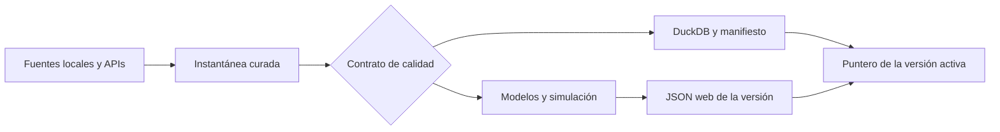

# Almacenamiento y publicación · F5 / B4

El proyecto trabaja con fuentes locales en `data/raw`, transformaciones en `data/clean` e instantáneas curadas en CSV y Parquet. DuckDB materializa las tablas fuente y de modelo para hacer consultas SQL. El frontend lee los JSON del mismo lote publicado.



## Granularidad

| Objeto en DuckDB | Una fila | Uso |
|---|---|---|
| `dw.dim_provincia` | Provincia INE | Nombres y comunidades |
| `dw.dim_tiempo` | Mes | Fechas de los hechos |
| `dw.dim_fuente` | Fuente y recurso | Registro de descarga disponible |
| `dw.fact_provincia_mes` | Provincia y mes | Clima, caracterización y variables repetidas para los modelos |
| `dw.fact_energia_ccaa_mes` | CCAA o ciudad autónoma y mes | Demanda y generación sin multiplicar por provincias |
| `dw.fact_energia_nacional_mes` | Mes | Precio nacional y emisiones |
| `dw.fact_reservas_ambito_mes` | Ámbito hidrográfico y mes | Reservas y capacidad de embalse |
| `dw.dim_municipio` | Municipio oficial | Población INE, superficie GISCO, densidad y años de referencia |
| `dw.fact_capacidad_nudo` | Registro de nudo REE | Nudo, subestación, CCAA y capacidades declaradas |
| `meta.publicacion` | Lote | Identificador, fecha del panel y generación |

Las variables repetidas del panel sirven para cruzar características con una provincia. Para agregar demanda por cobertura territorial, usa la vista por CCAA. La vista por cuenca contiene los ámbitos representados en el panel. Los porcentajes requieren el denominador apropiado para combinarlos. La tabla de nudos conserva su propia granularidad. La ubicación de un municipio no permite inferir qué nudo lo abastecería.

```sql
SELECT SUM(demanda_ccaa_mwh) / 1e6 AS demanda_twh
FROM dw.fact_energia_ccaa_mes
WHERE mes = DATE '2025-12-01';
```

## Validación y recuperación

**Recomendación (no viene de clase).** El control de publicación verifica claves, los 52 códigos de provincia, cobertura de CCAA, los 12 últimos meses consecutivos, el mes efectivo y la cobertura mínima por indicador en su propia granularidad. El modo degradado solo admite cobertura parcial de demanda con historial utilizable y muestra el aviso en el mapa.

Los ficheros de cada versión se completan por separado. `frontend/public/data/publicacion.json` se sustituye al final y es la única referencia mutable. Los dos JSON web llevan el identificador del lote y DuckDB lo guarda en `meta.publicacion`. `data/publicaciones/<versión>/manifiesto.json` recoge hashes, cobertura y origen de las previsiones. Las versiones anteriores permanecen disponibles tras un fallo.

Los proveedores mantienen sus cachés de origen según las reglas de cada fuente. La huella de publicación corresponde a las entradas curadas consumidas. Para volver a entrenar un resultado histórico, conserva también la instantánea de origen y la demanda nacional limpia.
