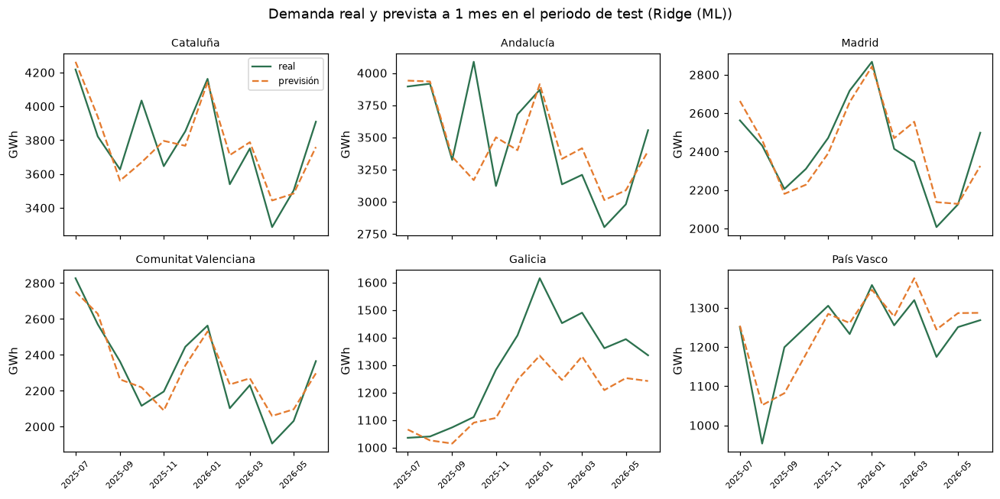

# Model card · Demanda eléctrica mensual por comunidad autónoma

> Generado por `python -m cpd.modelos` el 17/11/2026. No editar a mano: se sobrescribe al volver a ejecutar.

> Esta ficha evalúa la demanda a 1 y a 12 meses vista con un único periodo de test. **La previsión a 1 año que usa el
> mapa** (combinación de modelos elegida con 24 orígenes de backtesting) está en
> [previsiones_1_anio.md](../analisis/previsiones_1_anio.md).

## Datos

- Fuente y tabla: `data/curated/panel_provincia_mes`, columna `demanda_ccaa_mwh` (Red Eléctrica REData).
- Granularidad: comunidad autónoma × mes (19 comunidades, incluidas Baleares, Canarias, Ceuta y Melilla).
- Periodo de entrenamiento: primer mes con features completas (2017) a 2024-06.
- Periodo de validación: 2024-07 a 2025-06.
- Periodo de test: 2025-07 a 2026-06 (usado una vez).
- Features: lags de `h`, `h+1`, `h+2`, 12 y 24 meses; medias de 3 y 6 meses; volatilidad y tendencia de 12 meses;
  mes del año (seno, coseno y variables binarias) y confinamiento de 2020. Todas relativas al nivel de los 12 meses
  que terminan en `t − h`, en logaritmo. Diccionario: `data/curated/modelos/diccionario_features.csv`
  (se regenera con el comando).
- Calidad: la demanda imposible de REData (jul-ago de 2026 sin saldo de intercambios; oct-2025 en tres comunidades del
  norte) llega en NaN desde el curado. Los huecos del final se recortan y 3 meses intermedios se sustituyen por
  el mismo mes del año anterior, solo como entrada y marcados (ver el
  [informe EDA](../analisis/eda_panel.md#7-datos-atípicos-de-la-demanda-r-10)).
- Escalado (solo Ridge): `StandardScaler` dentro del pipeline, ajustado solo con entrenamiento (R-7).

## Objetivo

Demanda eléctrica del mes `t` de cada comunidad (MWh), con los datos conocidos hasta `t − h`. Dos horizontes:
`h` = 1 mes y `h` = 12 meses. El modelo predice `log(demanda / nivel)` y se convierte a MWh.

## Baselines

- Último valor (naive): demanda de `t − h`.
- Mismo mes del año anterior (estacional): demanda de `t − 12`. Con `h` = 12 coincide con el naive.
- Tendencia + estacionalidad: `cpd.forecast.prever_mensual`, reajustado en cada origen.

## Métrica principal

**MAPE** = media de |real − previsión| / real × 100. Se elige porque las comunidades tienen escalas muy distintas y
porque el error relativo es lo que se traslada al simulador (impacto local). Coste del error: sobreestimar la demanda
de la zona exagera el impacto local del CPD; infraestimarla lo esconde. El coste es simétrico.

## Resultados

Tabla completa (validación y test de todos los modelos): [metricas.md](../analisis/metricas.md).

| Horizonte | Mejor baseline (test) | Modelo elegido | MAPE test del elegido |
|---|---|---|---|
| 1 mes | Mismo mes del año anterior (estacional): 4,88 % | Ridge (ML) (alpha=0.1) | 4,40 % |
| 12 meses | Mismo mes del año anterior (estacional): 4,88 % | Mismo mes del año anterior (estacional) | 4,88 % |

- **A 1 mes**, el modelo elegido mejora al mejor baseline en test.
- **A 12 meses**, ningún modelo ML supera al "mismo mes del año anterior" en validación, así que se elige el
  baseline. Se documenta en lugar de forzar un modelo peor: la demanda anual de cada comunidad es muy estable y las
  features disponibles no anticipan sus cambios (crisis, eficiencia, autoconsumo).

**Figura.** Demanda real y previsión a 1 mes en el periodo de test para seis comunidades.

Intervalo de la previsión final: cuantiles del 5 % y el 95 % de los errores relativos del modelo elegido en
validación (de -4,4 % a +12,0 % al mes). La suma de
12 meses suma también los extremos, así que es un intervalo conservador.

## Sesgos y comprobaciones

- Paradoja de la exactitud: no aplica (regresión).
- Por subgrupo (MAPE de test a 1 mes del modelo elegido, por comunidad; detalle en
  `data/curated/modelos/predicciones_demanda.csv`): más error en Cantabria (9,3 %), Galicia (8,9 %), Extremadura (6,9 %); menos en
  Canarias (1,6 %), La Rioja (2,0 %), Comunidad Foral de Navarra (2,3 %).
- Fuga: un test (`tests/test_modelos.py`) comprueba que cambiar la demanda posterior a `t − h` no cambia las features.
- Particiones: un test comprueba que entrenamiento < validación < test (R-6).

## Previsión de los próximos 12 meses

| Comunidad | Hasta | Últimos 12 meses (GWh) | Previsión 12 meses (GWh) |
|---|---|---|---|
| Andalucía | 2026-06 | 41.573 | 41.573 |
| Aragón | 2026-06 | 11.369 | 11.369 |
| Asturias | 2026-06 | 8.259 | 8.259 |
| Illes Balears | 2026-10 | 6.659 | 6.659 |
| Canarias | 2026-10 | 9.137 | 9.137 |
| Cantabria | 2026-06 | 3.741 | 3.741 |
| Castilla y León | 2026-06 | 13.336 | 13.336 |
| Castilla-La Mancha | 2026-06 | 12.243 | 12.243 |
| Cataluña | 2026-06 | 45.353 | 45.353 |
| Comunitat Valenciana | 2026-06 | 27.718 | 27.718 |
| Extremadura | 2026-06 | 5.081 | 5.081 |
| Galicia | 2026-06 | 15.599 | 15.599 |
| Madrid | 2026-06 | 28.956 | 28.956 |
| Región de Murcia | 2026-06 | 9.359 | 9.359 |
| Comunidad Foral de Navarra | 2026-06 | 4.838 | 4.838 |
| País Vasco | 2026-06 | 14.876 | 14.876 |
| La Rioja | 2026-06 | 1.539 | 1.539 |
| Ceuta | 2026-10 | 209 | 209 |
| Melilla | 2026-10 | 238 | 238 |

Como el modelo a 12 meses es el estacional, la previsión repite el último año. Las comunidades peninsulares
terminan en junio de 2026 porque REData aún no publica el saldo de intercambios de julio y agosto.

## Limitaciones

- No prevé a 10 años: para la pregunta P5 sigue valiendo `cpd.forecast` (tendencia + estacionalidad), con una
  incertidumbre que crece con el horizonte. Un modelo con lags no se puede extender 120 meses sin acumular error.
- No incluye el efecto de un CPD nuevo sobre la demanda ni variables externas (PIB, precios, autoconsumo).
- La demanda es de comunidad: no distingue provincias.

## Uso previsto y uso no previsto

- Previsto: dar contexto en la ficha del mapa (demanda de la comunidad) y comparar el consumo de un CPD con la
  demanda de su zona.
- No previsto: planificar la red eléctrica o tomar decisiones de inversión sin revisión humana.

## Reproducción

`.\.venv\Scripts\python.exe -m cpd.modelos` (semilla 42; versiones en `requirements.txt`).
Salidas en `data/curated/modelos/` y modelo guardado en `models/demanda_ccaa_h1.joblib` (fuera de git).
Entrenado el 17/11/2026.
