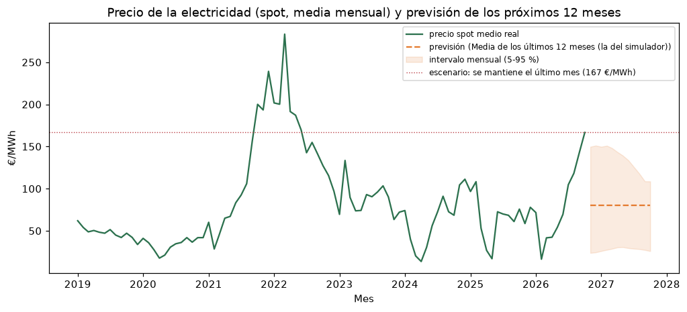

# Model card · Precio medio mensual de la electricidad (`precio_luz`)

> Generado por `python -m cpd.modelos` el 17/11/2026. No editar a mano: se sobrescribe al volver a ejecutar.

## Datos

- Fuente y tablas: `data/curated/tablas/precios_diarios` (spot diario REData/OMIE, €/MWh → media mensual),
  `reservas_ambito_mensual` (MITECO, 16 ámbitos → reserva nacional) y `co2` (REData, emisiones del sistema).
- Granularidad: nacional (sistema peninsular) × mes. Solo meses completos (se quita el mes en curso).
- Periodo de entrenamiento: meses objetivo de 2017 a 2024-10 (incluye la crisis de 2021-2022).
- Periodo de validación: 2024-11 a 2025-10.
- Periodo de test: 2025-11 a 2026-10 (usado una vez).
- Features (`cpd.features.precio`, origen `r = t − h`): último precio, penúltimo, media de 3 meses, mismo mes del año
  anterior, tendencia anual, volatilidad, reserva hídrica nacional y su variación anual, CO2 relativo, mes del
  año (seno y coseno) y horizonte. Todas relativas al nivel de 12 meses y en logaritmo. Diccionario en
  `data/curated/modelos/diccionario_features.csv`.
- Escalado: `StandardScaler` dentro del pipeline de Ridge, ajustado solo con entrenamiento (R-7).

## Objetivo

Precio spot medio de cada uno de los 12 meses siguientes (€/MWh) y su media, que es el dato que entra en el OPEX
del simulador. Un solo modelo para los horizontes de 1 a 12 meses (previsión directa; el horizonte es una feature).

## Baselines

- Último mes (naive): el precio del mes de origen.
- **Media de los últimos 12 meses: es lo que usa hoy el simulador.**
- Mismo mes del año anterior (estacional).
- Tendencia + estacionalidad (`cpd.forecast.prever_mensual`).

## Métrica principal

**MAE (€/MWh)** = media de |real − previsión|. Se elige porque el error del precio pasa directamente al coste de
la energía: con un CPD de 50 MW de TI (unos 455 GWh al año con PUE 1,3), 10 €/MWh de error son unos 4,5 M€ al año de
OPEX. El MAPE no sirve como métrica principal: se dispara en los meses con precios muy bajos. Coste del error:
infraestimar el precio es más peligroso que sobreestimarlo (hace parecer rentable un CPD que no lo es).

## Resultados

| Modelo | MAE validación | MAE test | MAE test a 1 mes | Error de la media anual (backtesting) | Error de la media anual (test) |
|---|---|---|---|---|---|
| Media de los últimos 12 meses (la del simulador) | 23,5 | 35,7 | 32,3 | 62,0 | -8,4 |
| Mismo mes del año anterior (estacional) | 24,2 | 43,4 | 43,4 | 62,0 | -8,4 |
| Último valor (naive) | 36,8 | 39,1 | 20,7 | 39,9 | -4,7 |
| Ridge (ML) | 41,9 | 31,3 | 18,6 | 64,6 | 1,3 |
| Tendencia + estacionalidad (`forecast.py`) | 51,2 | 44,6 | 40,6 | 61,3 | 35,6 |
| Gradient boosting (ML) | 65,6 | 35,7 | 24,9 | 106,7 | -22,8 |

Todos los valores están en €/MWh. Backtesting: 16 orígenes trimestrales de 2020 a 2023, con
reentrenamiento en cada origen. Test anual: origen 2025-10
(error = previsión − real).

**Modelo elegido con la validación: Media de los últimos 12 meses (la del simulador).**
Ningún modelo de ML supera en validación a la media de los últimos 12 meses: es decir, **el supuesto que ya usaba el simulador es la mejor previsión disponible del precio anual**. La explicación más probable: sin el precio del gas (que no está entre las fuentes) no se pueden anticipar los cambios de régimen, y el entrenamiento está dominado por la crisis de 2021-2022. Se documenta en lugar de forzar un modelo peor.
En test, Ridge (ML) habría sido algo mejor (31,3 frente a 35,7 €/MWh), pero el modelo se elige con la validación y el test solo se mira una vez.

Matiz importante: en el backtesting de 2020-2023, el que mejor acierta la media del año siguiente es
**Último valor (naive)** (39,9 €/MWh de error medio), porque en esos años el precio cambió de
nivel varias veces y el último mes recoge antes el cambio. Con el criterio fijado de antemano (MAE mensual en
validación) se mantiene el modelo elegido.

**Figura.** Precio real, previsión de los 12 meses siguientes con su intervalo y el escenario «el precio se queda
como el último mes».

Selección de configuraciones de ML (validación):

| Familia | Configuración | MAE validación (€/MWh) |
|---|---|---|
| ridge | alpha=1 | 72,9 |
| ridge | alpha=10 | 72,1 |
| ridge | alpha=100 | 66,5 |
| ridge | alpha=1000 | 41,9 |
| gradient_boosting | learning_rate=0.03, max_depth=2 | 66,4 |
| gradient_boosting | learning_rate=0.03, max_depth=3 | 65,6 |
| gradient_boosting | learning_rate=0.1, max_depth=2 | 72,9 |
| gradient_boosting | learning_rate=0.1, max_depth=3 | 71,8 |

## Previsión actual

- Precio medio previsto para los 12 meses siguientes a 2026-10: **80,5 €/MWh**
  (rango probable 45-282 €/MWh, cuantiles del 10 % y el 90 % del error
  de la media anual en el backtesting).
- Escenario «se mantiene el último mes»: **166,7 €/MWh** (2026-10).
- **Aviso:** el precio sube desde julio de 2026 (en 2026-10, 167 €/MWh frente a
  80 de media en 12 meses). Si es un cambio de régimen como el de 2021, la media de 12 meses
  lo infraestima. El mapa enseña el VAN con los dos extremos del rango.

## Sesgos y comprobaciones

- Paradoja de la exactitud: no aplica (regresión).
- Por horizonte: el error a 1 mes es menor que a 12 (tabla de [metricas.md](../analisis/metricas.md)).
- Fuga: `tests/test_modelos.py` comprueba que cambiar los datos posteriores al origen no cambia las features.
- Particiones: entrenamiento < validación < test por mes objetivo (R-6).

## Limitaciones

- No hay precio del gas (MIBGAS o TTF) ni precios de futuros (OMIP), que son lo que de verdad anticipa el precio
  del año siguiente. Es la mejora más clara (recomendación, no viene de clase).
- Una sola serie nacional con unos 120 meses útiles: pocos datos para un modelo con muchas features.
- El precio que paga un CPD depende de su contrato (PPA, tarifas de acceso), no solo del spot.

## Uso previsto y uso no previsto

- Previsto: dar el precio de referencia y su rango al simulador y enseñar la sensibilidad del VAN en el mapa.
- No previsto: comprar energía o cerrar un contrato con esta previsión.

## Reproducción

`.\.venv\Scripts\python.exe -m cpd.modelos` (semilla 42; versiones en `requirements.txt`). Salidas en
`data/curated/modelos/` (`prevision_precio_luz.csv`, `resumen_precio_luz.json`, `metricas_precio.csv`,
`media_anual_precio.csv`). Entrenado el 17/11/2026.
