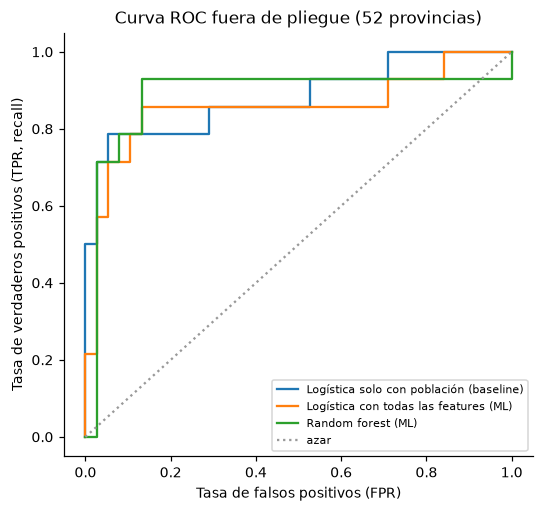

# Model card · Probabilidad de que una provincia tenga un CPD (`prob_cpd`)

> Generado por `python -m cpd.modelos` el 17/11/2026. No editar a mano: se sobrescribe al volver a ejecutar.

## Datos

- Fuente y tabla: `data/curated/panel_provincia_mes` resumido a una fila por provincia
  (`cpd.features.provincia.features_estaticas_provincia`).
- Etiqueta: `tiene_cpd` = 1 si hay al menos un centro de datos en PeeringDB (14 de 52 provincias).
- Granularidad: provincia (transversal, sin tiempo).
- Validación: no hay fechas de apertura de los CPD, así que **no se puede hacer una partición temporal** (R-6 no
  aplica). Se usa validación cruzada estratificada repetida: 5 pliegues × 20 repeticiones, semilla 42. El
  hiperparámetro `C` de la logística se elige con una validación cruzada interna (anidada).
- Features: log de población, renta por persona, paro, temperatura media, % de free cooling, estrés hídrico,
  subestaciones de 220-400 kV, % de Red Natura 2000, capacidad de acceso de la comunidad, terremotos y si es
  extrapeninsular. **Excluidas por fuga:** `n_ixp` y `distancia_ixp_km` (los IXP están dentro de centros de datos).
- Nulos e imputación: mediana, ajustada dentro de cada pliegue (solo falta la capacidad de acceso de Melilla).
  Escalado: `StandardScaler` dentro del pipeline (R-7).

## Objetivo

Probabilidad (0-1) de que una provincia con esas características tenga un centro de datos. Es una **propensión**:
dice a qué se parece una provincia, no si se va a construir un CPD nuevo.

## Baselines

- Clase mayoritaria: log-loss 0,584; accuracy 73,1 %.
- Logística solo con población: log-loss 0,377; ROC-AUC 0,882.

## Métrica principal

**Log-loss** (pérdida logarítmica) [C3 p.14]: −media(y·log p + (1−y)·log(1−p)). Se elige porque el mapa muestra la
probabilidad y esta métrica castiga las probabilidades seguras y equivocadas. Se mira también ROC-AUC [C3 p.19].
Coste de los errores: un falso positivo (provincia "parecida a las que tienen CPD" que no lo es) solo lleva a estudiarla
más; un falso negativo esconde una buena candidata. Por eso el umbral se elige con la curva ROC (índice de Youden) en
lugar de fijarlo en 0,5.

## Resultados

| Modelo | Log-loss | ROC-AUC | Brier | Accuracy (0,5) |
|---|---|---|---|---|
| Clase mayoritaria (baseline) | 0,584 | 0,500 (constante) | 0,197 | 73,1 % |
| Logística solo con población (baseline) | 0,377 | 0,882 | 0,115 | 86,5 % |
| Logística con todas las features (ML) | 0,394 | 0,855 | 0,117 | 84,6 % |
| Random forest (ML) | 0,422 | 0,885 | 0,124 | 84,6 % |

**Modelo elegido: Logística solo con población (baseline).** Con 52 provincias, añadir variables no mejora la log-loss: la
población explica casi todo y el resto añade ruido (sobreajuste). Se documenta en lugar de elegir un modelo más
complejo y peor.

**Figura.** Curvas ROC fuera de pliegue de los cuatro modelos.

**Umbral elegido** (Youden): 0,40. Matriz de confusión con ese umbral:

| | Predice "con CPD" | Predice "sin CPD" |
|---|---|---|
| Tiene CPD | 11 (verdaderos positivos) | 3 (falsos negativos) |
| No tiene CPD | 2 (falsos positivos) | 36 (verdaderos negativos) |

Accuracy 90,4 %, precision 0,85, recall (TPR) 0,79, FPR 0,05, F1 0,81.

**Coeficientes de la logística con todas las features** (ajustada con las 52 provincias, `C` = 0,30;
solo para interpretar):

| Feature | Coeficiente (estandarizado) |
|---|---|
| log_poblacion | 0,96 |
| renta_persona_eur | 0,76 |
| pct_horas_free_cooling | -0,34 |
| estres_hidrico_wri_0_1 | 0,29 |
| extrapeninsular | 0,26 |
| terremotos_m3_por_anio | 0,26 |
| pct_superficie_natura2000 | -0,19 |
| tmedia_anual_c | 0,15 |
| subestaciones_220_400kv | 0,12 |
| paro_por_1000_hab | 0,06 |
| capacidad_acceso_ccaa_mw | -0,00 |

## Sesgos y comprobaciones

- **Paradoja de la exactitud:** comprobada. Predecir siempre "sin CPD" acierta el 73,1 %
  y no detecta ninguna provincia con CPD; el modelo elegido se compara con ese mínimo en log-loss y ROC-AUC.
- **Por subgrupo** (con el umbral elegido):

| Subgrupo | Provincias | Con CPD (real) | Probabilidad media | Falsos positivos | Falsos negativos |
|---|---|---|---|---|---|
| Islas, Ceuta y Melilla | 5 | 60 % | 26 % | 0 | 0 |
| Península | 47 | 23 % | 27 % | 2 | 3 |
| población baja | 18 | 6 % | 5 % | 0 | 1 |
| población media | 17 | 12 % | 22 % | 0 | 2 |
| población alta | 17 | 65 % | 55 % | 2 | 0 |

- Provincias sin CPD con más probabilidad (candidatas): Cádiz (50 %), Coruña, A (44 %), Asturias (39 %), Zaragoza (38 %), Pontevedra (36 %).
- Provincias con CPD y poca probabilidad (el modelo no las explica): Araba/Álava (7 %), León (11 %), Gipuzkoa (26 %).

## Limitaciones

- 52 filas y 14 positivos: las métricas tienen mucha incertidumbre (una provincia más o menos cambia el ROC-AUC
  unas centésimas).
- PeeringDB no recoge todos los CPD (solo los registrados para interconexión).
- Elegir entre los cuatro modelos con las mismas predicciones fuera de pliegue con que se informa es algo optimista;
  con tan pocos datos no hay un test aparte.
- No dice por qué una provincia tiene CPD (correlación, no causalidad).

## Uso previsto y uso no previsto

- Previsto: dato de contexto en la ficha del mapa ("probabilidad de que se instale un CPD") y lista de provincias
  parecidas a las que ya tienen CPD.
- No previsto: decidir una inversión, ni comparar provincias como si fuera una probabilidad de éxito.

## Reproducción

`.\.venv\Scripts\python.exe -m cpd.modelos` (semilla 42; versiones en `requirements.txt`). Salida en
`data/curated/modelos/prob_cpd_provincia.csv`; modelo final en `models/prob_cpd.joblib` (fuera de git).
Entrenado el 17/11/2026.
