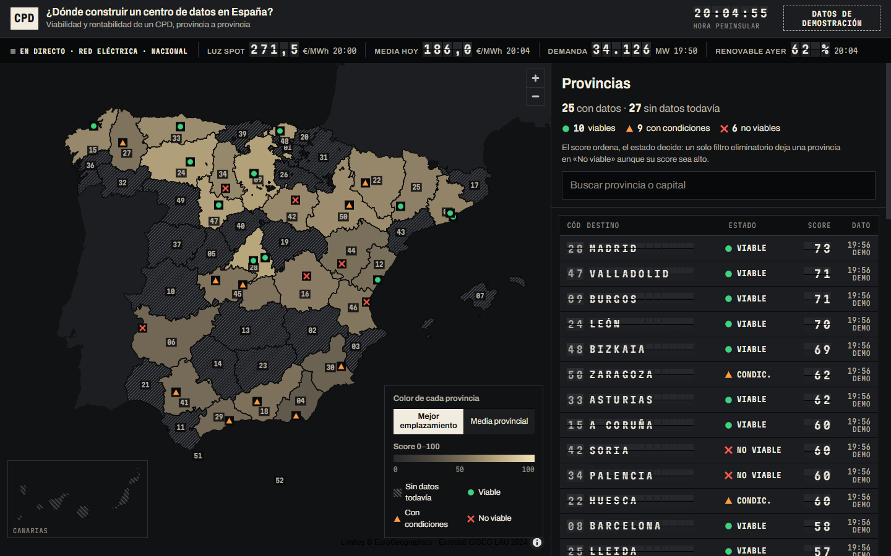

# Frontend · Mapa de viabilidad de un CPD en España

Mapa interactivo de España para el Proyecto 3. Pulsas una provincia, el mapa entra en ella (con sus municipios
reales) y el tablero de la derecha muestra si sería viable y rentable construir allí un CPD (centro de datos):
estado, score 0–100 con sus motivos, CAPEX, OPEX, VAN, ROI, payback, luz, agua, clima, red y emisiones.
Arriba, datos **en directo** de la red eléctrica; en cada provincia, el tiempo actual de su capital.



## Cómo ejecutarlo

Requisitos: Node.js 20 o superior (probado con Node 24).

```powershell
cd frontend
npm install
npm run dev
```

Se abre en http://localhost:5173. No hace falta ninguna clave de API.

| Comando | Qué hace |
| --- | --- |
| `npm run dev` | Servidor de desarrollo |
| `npm run build` | Comprueba tipos y genera `dist/` (estático, se puede abrir con cualquier servidor web) |
| `npm run preview` | Sirve la versión de `dist/` |
| `npm test` | Tests (vitest): el recálculo en TypeScript da las mismas cifras que el modelo de Python |
| `npm run data` | Regenera `public/data/viabilidad.json` con el modelo de Python |
| `npm run geo` | Regenera los límites de provincias y municipios (`public/data/*.geojson`) |

## Cómo se usa

- **Vista de España:** cada provincia se colorea según su score (más clara = mejor). Rayado = *sin datos todavía*.
  Las lámparas son los municipios analizados: ● viable, ▲ con condiciones, ✕ no viable (forma y color, no solo color).
  El número de cada provincia es su código INE, el mismo que en el tablero.
- **Color de cada provincia:** *Mejor emplazamiento* (score del mejor municipio) o *Media provincial*.
- **Pulsar una provincia** (en el mapa, en la lista o en el recuadro de Canarias) hace zoom y abre su ficha.
  Dentro se ven sus municipios reales; pasar el ratón muestra el nombre y la superficie.
  Si hay varios municipios analizados, se elige cuál ver con los botones de la ficha o pulsando su lámpara.
- **Volver:** botón *Toda España* o tecla `Esc`. Cada vista tiene su enlace (`#/provincia/28`, `#/provincia/28/28079`).
- **Teclado:** la lista del tablero es navegable con `Tab` y tiene buscador; el mapa admite flechas y `+`/`−`.
  Con *reducir movimiento* activado en el sistema no hay animaciones de vuelo ni de paletas.

## De dónde sale cada dato

| Dato | Origen | ¿Real? |
| --- | --- | --- |
| Límites de provincias y municipios, nº de municipios, superficie | Eurostat GISCO, LAU 2024 (`data/raw/municipios`) | **Real** |
| Estado, score, motivos, sub-scores, CAPEX, OPEX, VAN, ROI, payback, agua, PUE, CO₂, latencia… | Modelo del proyecto (`src/cpd/scoring.py` → `evaluar()`) sobre `data/demo/municipios_demo.csv` | **Sintético** (28 municipios con indicadores inventados pero plausibles; nombres, códigos INE y coordenadas reales) |
| Precio spot de la luz (cada 15 min, hoy y mañana), media del día | REData de Red Eléctrica, `mercados/precios-mercados-tiempo-real` | **Real, en directo** (nacional) |
| Demanda eléctrica peninsular (cada 5 min) | REData, `demanda/demanda-tiempo-real` | **Real, en directo** (nacional) |
| % renovable de ayer y t CO₂/MWh de la red | REData, `generacion/evolucion-renovable-no-renovable` y `generacion/no-renovables-detalle-emisiones-CO2` | **Real, en directo** (nacional) |
| Temperatura, humedad y viento ahora en cada capital | Open-Meteo (`/v1/forecast?current=…`, una sola llamada para las 52 capitales) | **Real, en directo** |

En pantalla cada cifra lleva su etiqueta: **EN DIRECTO hh:mm**, **DEMO** (modelo con datos sintéticos),
**GISCO LAU 2024** (dato oficial) o **SUPUESTO** (parámetro del modelo, p. ej. 75 €/MWh). Arriba a la derecha hay un
sello permanente de *Datos de demostración* mientras la tabla de municipios sea sintética.

Las provincias sin municipios en la tabla **no tienen ninguna cifra inventada**: muestran *SIN DATOS TODAVÍA*,
sus datos geográficos reales y el tiempo en directo de su capital.

### Datos en directo

- Se piden desde el navegador (REData y Open-Meteo permiten CORS, no hace falta proxy) y se refrescan solos:
  precio y demanda cada 5 min, mix cada 30 min, tiempo cada 10 min. Se pausan con la pestaña oculta.
- Precio y demanda son **nacionales (sistema peninsular)**: son los mismos para todas las provincias y así se indica.
- Si una fuente falla, se ve *SIN CONEXIÓN*, un mensaje claro y un botón *Reintentar*; las cifras económicas siguen
  usando el precio del modelo. Si falla una actualización posterior, se conserva el último dato bueno.
- Open-Meteo es gratuito para uso no comercial (como este proyecto académico).

### «Si todo el año la luz costara como hoy»

En la ficha de cada provincia con datos se recalcula la economía con la **media del precio spot de hoy** en lugar de
los 75 €/MWh de `config/settings.yaml`. Se usan exactamente las fórmulas de `simular_municipio()`
(`src/model/finanzas.ts`): solo cambia el precio; el 80 % del coste eléctrico se repercute al cliente, por eso el VAN
cambia menos que la factura. Un test comprueba que, con 75 €/MWh, el resultado es idéntico al de Python para los 28
municipios.

## Regenerar los datos

**Modelo (`public/data/viabilidad.json`).** Desde `frontend/`:

```powershell
npm run data
```

Usa el Python de `..\.venv` (o el de la variable `PYTHON`). Equivale a:

```powershell
..\.venv\Scripts\python.exe scripts\export_data.py
```

Cuando exista la tabla maestra real (mismas columnas que `municipios_demo.csv`), basta con:

```powershell
npm run data -- --csv ..\data\curated\tabla_maestra.csv
```

El mapa se actualiza solo: las provincias que entren en la tabla dejarán de salir rayadas, y el sello de datos de
demostración desaparece si ninguna fila de `origen_datos` es sintética.

**Límites (`public/data/provincias.geojson`, `contexto.geojson`, `municipios/*.geojson`).** Ya están generados y
versionados. Para rehacerlos hacen falta los datos raw (`scripts\descargar_datos_raw.ps1` en la raíz):

```powershell
npm run geo
```

Las provincias se obtienen disolviendo los 8.132 municipios LAU por los dos primeros dígitos de su código INE, así
encajan exactamente con sus municipios (Baleares y Canarias incluidas, que en NUTS-3 van por islas). Los municipios
de cada provincia se guardan en un fichero aparte (máx. ~250 KB) y solo se descargan al entrar en ella.

## Tecnología y por qué

- **Vite + React + TypeScript:** arranque inmediato, tipos estrictos para el contrato de datos con Python.
- **MapLibre GL JS (WebGL):** zoom y vuelo de cámara fluidos, estilos según los datos y estado *hover* por
  provincia y municipio, sin mapa base de terceros: **sin claves, sin teselas externas y funciona sin internet**
  (salvo los datos en directo).
- **mapshaper** (solo en desarrollo) para simplificar y disolver los límites oficiales.
- Tipografías autoalojadas (Martian Mono y Archivo, vía Fontsource), sin Google Fonts en tiempo de ejecución.

## Diseño

Mundo visual *Tablero de salidas*: cada provincia es un destino anunciado en un panel *split-flap*, con su estado,
su score y la hora de su dato. Módulos negros mate con juntas finas, caracteres que giran al cambiar, lámparas de
estado con forma propia y amarillo reservado a la provincia activa. Pensado para leerse proyectado en la defensa y de
cerca en el portátil o el móvil. Contexto de producto en [PRODUCT.md](PRODUCT.md) y sistema visual en
[DESIGN.md](DESIGN.md).

## Estructura

```
frontend/
  index.html, vite.config.ts, tsconfig.json, package.json
  public/data/             viabilidad.json, provincias.geojson, contexto.geojson, municipios/<código>.geojson
  scripts/export_data.py   modelo de Python -> viabilidad.json
  scripts/run_export.mjs   lanza export_data.py con el Python del .venv
  scripts/build_geo.mjs    límites GISCO LAU 2024 -> GeoJSON simplificados
  src/App.tsx              estado, rutas (#/provincia/..), datos en directo
  src/components/          MapaEspana, Tablero, Ficha, Franja, Flap (split-flap), Leyenda, CanariasRecuadro…
  src/live/                clientes de REData y Open-Meteo, sondeo con pausa y reintento
  src/model/               recálculo financiero (con test) y colores
```

## Pendiente / limitaciones

- La tabla de municipios es **sintética** hasta que la fase de ingesta construya la tabla maestra real.
- Solo hay 28 municipios analizados (25 provincias); el resto aparece como *sin datos todavía*.
- Los sub-scores se normalizan entre los municipios de la tabla (min-max): cambiarán al añadir municipios.
- El recálculo con el precio de hoy es una ilustración («si todo el año fuera como hoy»), no una previsión.
- ESIOS y AEMET (más detalle, necesitan clave gratuita) no se usan.
